# Sistem Cuti & Pemesanan Tiket (US-1a sampai US-9): spesifikasi lengkap

Nama kerja aplikasi: **CutiTerbang** (usulan; belum final).

Dokumen ini menggabungkan empat artifact menjadi satu file Markdown:

1. **Model Domain** (Claude Doc): konteks terbatas, kelas, atribut, invarian OCL, kontrak operasi, celah.
2. **Diagram Use Case**: aktor, relasi antar-use case, dan deskripsi 18 use case (templat Cockburn).
3. **Diagram Aktivitas & Robustness**: 36 diagram. Diagram gambar tidak dapat dimasukkan ke Markdown, jadi bagian robustness dituliskan sebagai daftar boundary, control, entity, dan hubungannya.
4. **Diagram Sequence**: 18 diagram, dituliskan ulang sebagai kode Mermaid (`sequenceDiagram`) beserta tabel penelusuran langkah ke pesan, dan daftar operasi baru yang diusulkan untuk Model Domain.

Bahasa dokumen: Indonesia. Nama kelas, nama use case, dan pesan sistem sengaja memakai istilah dari story (bahasa bersama), jadi pakai istilah yang sama di kode, UI, dan tes.

## Keputusan arsitektur (untuk implementasi)

- **Satu aplikasi, dua modul, satu login bersama.** Model Domain memisahkan dua konteks terbatas yang tidak berbagi konsep: **A. Manajemen Cuti** (US-1a sampai 1c) dan **B. Pemesanan Tiket** (US-2a sampai 9). Keduanya hanya berbagi login dan pemeriksaan peran (subdomain "Identitas & Akses").
- Jaga kedua modul tetap terpisah: tidak ada referensi langsung antar-entity dari Cuti ke Tiket atau sebaliknya, supaya mudah dipisah kelak.
- Peran **HRD manajer** tidak dimodelkan sebagai kelas di domain cuti (hanya memengaruhi hak akses). Dalam aplikasi gabungan, peran ini harus punya tempat di model peran bersama. Lihat celah G2 dan G12.
- Di luar cakupan (jangan dibangun, cukup disimulasikan atau diberi data awal): Data Kepegawaian (jatah cuti, NIP, status pengajuan cuti, kalender kerja), sistem pembayaran (mengubah status ke Booked), Maskapai (mengonfirmasi kursi, mengubah status ke Confirmed), Layanan Email.

## Daftar isi

1. Model use case: aktor, relasi, penelusuran story
2. Deskripsi use case US-1a sampai US-9
3. Model domain
4. Robustness: boundary, control, entity per use case
5. Catatan diagram aktivitas dan aturan notasi
6. Diagram sequence: urutan pesan, operasi, dan lifeline per use case

---

# 1. Model use case

Dua subjek (batas sistem): **Sistem Manajemen Cuti** (US-1a, US-1b, US-1c) dan **Sistem Pemesanan Tiket** (US-2a sampai US-9).

## Aktor

| Aktor | Jenis | Deskripsi | Use case |
|---|---|---|---|
| HRD Manajer | Primer | Pegawai HRD yang memantau pengajuan cuti dan sisa cuti pegawai. | US-1a, US-1b, US-1c |
| Calon Penumpang | Primer | Orang yang mencari dan memesan tiket untuk dirinya sendiri. Pencarian dapat dilakukan tanpa login; pemesanan, pembatalan, dan "Tiket Saya" memerlukan login. | US-2a, US-2b, US-3 |
| Member Frequent Traveller | Primer; generalisasi dari Calon Penumpang | Calon penumpang yang terdaftar pada program keanggotaan dan memiliki data profil. Dapat melakukan semua hal yang dapat dilakukan calon penumpang. | US-4, US-5a, US-5b, US-6a, US-6b, US-6c, dan semua use case Calon Penumpang |
| Manajer Travel | Primer | Staf yang mencari, memesan, dan memantau tiket atas nama pengunjung. | US-7, US-8a, US-8b, US-9 |
| Pengunjung | Primer | Orang yang terdaftar di sistem, memiliki data profil, dan tiketnya dipesankan oleh manajer travel. | US-8c, US-8d |
| Data Kepegawaian «system» | Pendukung | Sistem luar yang menyediakan jatah cuti, NIP, status pengajuan cuti, dan kalender kerja. | US-1a, US-1b, US-1c |
| Maskapai «system» | Pendukung | Sistem luar yang mengonfirmasi kursi sehingga status booking menjadi Confirmed. | US-8d |
| Layanan Email «system» | Pendukung | Sistem luar untuk pengiriman email. | US-8d |

Sistem pembayaran tidak digambar sebagai aktor: sistem itu hanya mengubah status ke Booked, dan tidak ada story untuk perilaku tersebut.

## Relasi antar-use case

| Relasi | Extension point | Kondisi | Dasar |
|---|---|---|---|
| US-2a «extend» US-3 | hasil pencarian | Calon penumpang memilih satu penerbangan tersedia untuk dipesan. | US-2a bergantung pada US-3. US-3 tetap utuh tanpa pemesanan dan tanpa login. |
| US-6a «extend» US-3 | hasil pencarian | Member menerapkan filter jam. | US-6a bergantung pada US-3. |
| US-6b «extend» US-3 | hasil pencarian | Member mengurutkan hasil berdasarkan harga atau memilih penerbangan untuk dibandingkan. | US-6b bergantung pada US-3. |
| US-6c «extend» US-6b | tampilan perbandingan | Member memilih "Pesan" pada salah satu penerbangan. | US-6c bergantung pada US-6b. |
| US-6c «include» US-2a | n/a | Selalu: proses pemesanan mengikuti US-2a. | US-6c bergantung pada US-2a; Kontrak C1. |
| US-8b «extend» US-8a | hasil pencarian | Manajer travel memilih satu penerbangan tersedia untuk dipesan. | US-8b bergantung pada US-8a. |
| Member Frequent Traveller generalisasi dari Calon Penumpang | n/a | n/a | Tabel Peran; diagram kelas B1. |

Urutan pengerjaan lain (US-2b setelah US-2a, US-5b setelah US-5a, US-8c dan US-8d setelah US-8b) tidak digambar sebagai relasi, hanya ketergantungan data.

## Penelusuran story

| Story | Use case | Aktor primer | Tingkat |
|---|---|---|---|
| US-1a | Melihat pengajuan cuti per periode | HRD manajer | Tujuan pengguna |
| US-1b | Melihat riwayat cuti pegawai | HRD manajer | Tujuan pengguna |
| US-1c | Melihat sisa cuti pegawai | HRD manajer | Tujuan pengguna |
| US-2a | Memesan tiket | Calon penumpang | Tujuan pengguna |
| US-2b | Membatalkan pemesanan | Calon penumpang | Tujuan pengguna |
| US-3 | Mencari penerbangan | Calon penumpang | Tujuan pengguna |
| US-4 | Mencari penerbangan multi-destinasi | Member frequent traveller | Tujuan pengguna |
| US-5a | Memperbarui data profil | Member frequent traveller | Tujuan pengguna |
| US-5b | Memvalidasi tiket | Member frequent traveller | Tujuan pengguna |
| US-6a | Menyaring hasil pencarian berdasarkan jam keberangkatan | Member frequent traveller | Subfungsi |
| US-6b | Membandingkan harga penerbangan | Member frequent traveller | Subfungsi |
| US-6c | Memesan penerbangan dari tampilan perbandingan | Member frequent traveller | Tujuan pengguna |
| US-7 | Memantau status booking | Manajer travel | Tujuan pengguna |
| US-8a | Mencari penerbangan untuk pengunjung | Manajer travel | Tujuan pengguna |
| US-8b | Memesan tiket atas nama pengunjung | Manajer travel | Tujuan pengguna |
| US-8c | Melihat tiket yang dipesankan | Pengunjung | Tujuan pengguna |
| US-8d | Menerima e-tiket melalui email | Pengunjung | Tujuan pengguna |
| US-9 | Memeriksa status booking dengan kode booking reference | Manajer travel | Tujuan pengguna |

## Keputusan dan celah dari Model Domain

- **G4, diputuskan:** tidak ada pembatalan untuk pemesanan yang dibuat manajer travel (disengaja). Manajer Travel tidak terhubung ke US-2b.
- **G6, diputuskan:** e-tiket hanya dikirim untuk pemesanan manajer travel, ke email pada profil setiap pengunjung (`Pemesanan.penerimaETiket()`). Pemesanan lewat US-2a tidak menerima email, jadi US-8d hanya terhubung ke Pengunjung.
- **G12, terbuka:** story tidak menyatakan apakah US-4, US-5a, US-5b, dan US-8a memerlukan login. Deskripsi use case tersebut menandainya.

Catatan penulisan: pada deskripsi use case di bawah, "Ekstensi" diberi nomor langkah tempat ekstensi terjadi (2a = ekstensi pada langkah 2). `*a` berarti dapat terjadi pada langkah mana pun. "AC" = Acceptance Criteria pada story; "C1 sampai C4" = kontrak operasi pada Model Domain; "G" = celah Model Domain; "Asumsi" = asumsi pada story.

---
# 2. Deskripsi use case

Templat Cockburn *fully dressed*. Tingkat: "!" tujuan pengguna, "−" subfungsi.

## Konteks A: Sistem Manajemen Cuti

### US-1a Melihat pengajuan cuti per periode (!)

- **Tujuan:** HRD manajer mengetahui pegawai yang akan mengambil cuti pada periode yang dipilih beserta lama cutinya.
- **Aktor primer:** HRD manajer. **Pendukung:** Data Kepegawaian «system».
- **Pemangku kepentingan:** HRD manajer (daftar lengkap dan benar untuk periode yang dipilih); pegawai (data cutinya hanya terlihat oleh HRD manajer).
- **Prasyarat:** Pengguna sudah login, dan perannya dikenali oleh subdomain Identitas & Akses.
- **Jaminan minimal:** Data cuti hanya terlihat oleh HRD manajer. Data cuti tidak berubah.
- **Jaminan sukses:** HRD manajer melihat semua pengajuan cuti berstatus Diajukan atau Disetujui yang beririsan dengan periode, diurutkan dari tanggal mulai cuti paling awal.
- **Pemicu:** HRD manajer membuka daftar pengajuan cuti.
- **Skenario sukses utama:**
  1. HRD manajer memasukkan tanggal mulai dan tanggal akhir periode.
  2. Sistem memvalidasi periode.
  3. Sistem mengambil pengajuan cuti berstatus Diajukan atau Disetujui yang beririsan dengan periode dari Data Kepegawaian.
  4. Sistem menghitung lama cuti setiap pengajuan dalam hari kerja.
  5. Sistem menampilkan daftar yang diurutkan dari tanggal mulai cuti paling awal. Setiap baris memuat nama pegawai, tanggal mulai cuti, tanggal akhir cuti, lama cuti, dan status pengajuan cuti.
- **Ekstensi:**
  - *a. Pengguna dengan peran selain HRD manajer membuka fitur ini: Sistem menampilkan pesan "Anda tidak memiliki akses ke halaman ini", dan data cuti tetap tersembunyi. Use case berakhir.
  - 2a. Tanggal mulai atau tanggal akhir kosong: Sistem menolak input. HRD manajer kembali ke langkah 1.
  - 2b. Tanggal akhir lebih awal dari tanggal mulai: Sistem menolak input. HRD manajer kembali ke langkah 1.
  - 3a. Tidak ada pengajuan cuti yang memenuhi syarat: Sistem menampilkan pesan "Tidak ada pengajuan cuti pada periode ini".
- **Variasi teknologi dan data:** Hari kerja = Senin sampai Jumat di luar hari libur pada kalender kerja perusahaan. Tanggal mengikuti waktu server (WIB).
- **Informasi terkait:** AC1 sampai AC9; Asumsi 7; Model Domain: `PengajuanCuti.beririsan()`, `/lamaCuti`.

### US-1b Melihat riwayat cuti pegawai (!)

- **Tujuan:** HRD manajer mengetahui kapan saja seorang pegawai sudah mengambil cuti pada tahun berjalan.
- **Aktor primer:** HRD manajer. **Pendukung:** Data Kepegawaian «system».
- **Pemangku kepentingan:** HRD manajer (riwayat lengkap untuk tahun berjalan); pegawai (data cutinya hanya terlihat oleh HRD manajer).
- **Prasyarat:** Pengguna sudah login, dan perannya dikenali oleh subdomain Identitas & Akses.
- **Jaminan minimal:** Data cuti hanya terlihat oleh HRD manajer. Data cuti tidak berubah.
- **Jaminan sukses:** HRD manajer melihat semua pengajuan cuti berstatus Disetujui milik pegawai yang tanggal mulainya pada tahun berjalan, diurutkan dari tanggal mulai cuti paling baru.
- **Pemicu:** HRD manajer membuka riwayat cuti.
- **Skenario sukses utama:**
  1. Sistem menampilkan daftar pegawai berisi nama dan nomor induk pegawai.
  2. HRD manajer memilih satu pegawai.
  3. Sistem mengambil pengajuan cuti pegawai tersebut yang berstatus Disetujui dan tanggal mulainya pada tahun berjalan.
  4. Sistem menampilkan riwayat yang diurutkan dari tanggal mulai cuti paling baru. Setiap baris memuat tanggal mulai cuti, tanggal akhir cuti, dan lama cuti.
- **Ekstensi:**
  - *a. Pengguna dengan peran selain HRD manajer membuka fitur ini: Sistem menampilkan pesan "Anda tidak memiliki akses ke halaman ini", dan data cuti tetap tersembunyi. Use case berakhir.
  - 3a. Pegawai belum memiliki pengajuan cuti berstatus Disetujui pada tahun berjalan: Sistem menampilkan pesan "Belum ada riwayat cuti".
- **Variasi teknologi dan data:** Tahun berjalan = 1 Januari sampai 31 Desember pada tahun hari ini.
- **Informasi terkait:** AC1 sampai AC6; Model Domain: `Pegawai.riwayatCuti()`; Celah G9: cuti yang melewati 31 Desember dihitung pada tahun tanggal mulainya.

### US-1c Melihat sisa cuti pegawai (!)

- **Tujuan:** HRD manajer menilai apakah pengajuan cuti seorang pegawai masih dalam jatah.
- **Aktor primer:** HRD manajer. **Pendukung:** Data Kepegawaian «system».
- **Pemangku kepentingan:** HRD manajer (sisa cuti yang benar untuk tahun berjalan); pegawai (data cutinya hanya terlihat oleh HRD manajer).
- **Prasyarat:** Pengguna sudah login, dan perannya dikenali oleh subdomain Identitas & Akses.
- **Jaminan minimal:** Data cuti hanya terlihat oleh HRD manajer. Data cuti tidak berubah.
- **Jaminan sukses:** HRD manajer melihat sisa cuti pegawai pada tahun berjalan dalam hari kerja.
- **Pemicu:** HRD manajer membuka sisa cuti.
- **Skenario sukses utama:**
  1. Sistem menampilkan daftar pegawai berisi nama dan nomor induk pegawai.
  2. HRD manajer memilih satu pegawai.
  3. Sistem mengambil jatah cuti tahunan pegawai dari Data Kepegawaian.
  4. Sistem menghitung sisa cuti: jatah cuti tahunan dikurangi jumlah lama cuti dari pengajuan cuti berstatus Disetujui yang tanggal mulainya pada tahun berjalan.
  5. Sistem menampilkan sisa cuti dalam hari kerja.
- **Ekstensi:**
  - *a. Pengguna dengan peran selain HRD manajer membuka fitur ini: Sistem menampilkan pesan "Anda tidak memiliki akses ke halaman ini", dan data cuti tetap tersembunyi. Use case berakhir.
- **Variasi teknologi dan data:** Lama cuti dihitung dalam hari kerja.
- **Informasi terkait:** AC1 sampai AC4; Model Domain: `Pegawai./sisaCuti`; Celah G9: sisa cuti dapat bernilai negatif.

## Konteks B: Sistem Pemesanan Tiket

### US-2a Memesan tiket (!)

- **Tujuan:** Calon penumpang menjamin kursinya pada penerbangan yang dipilih.
- **Aktor primer:** Calon penumpang (juga member frequent traveller melalui generalisasi aktor). **Pendukung:** n/a.
- **Pemangku kepentingan:** Calon penumpang (kursi terjamin, dan pemesanan sesuai dengan ringkasan yang dilihatnya); Maskapai (kursi tidak terjual melebihi kapasitas).
- **Prasyarat:** Calon penumpang sedang melihat hasil pencarian US-3.
- **Jaminan minimal:** Jika pemesanan gagal, sistem tidak membuat pemesanan, dan sisa kursi tetap.
- **Jaminan sukses:** Sistem membuat satu pemesanan dengan satu kode booking reference unik dan status Waiting for the payment, lalu mencatat calon penumpang sebagai pemesan. Sisa kursi berkurang 1. Pemesanan tampil di "Tiket Saya" dengan informasi penerbangan yang sama dengan ringkasan.
- **Pemicu:** Calon penumpang memilih satu penerbangan tersedia dari hasil pencarian (extension point "hasil pencarian" pada US-3).
- **Skenario sukses utama:**
  1. Calon penumpang memilih satu penerbangan tersedia dari hasil pencarian.
  2. Sistem memastikan calon penumpang sudah login.
  3. Sistem meminta data penumpang wajib.
  4. Calon penumpang memasukkan data penumpang wajib.
  5. Sistem menampilkan ringkasan informasi penerbangan yang dipilih.
  6. Calon penumpang mengonfirmasi pemesanan.
  7. Sistem memvalidasi data penumpang dan memeriksa ketersediaan penerbangan.
  8. Sistem membuat pemesanan dengan satu kode booking reference, mencatat calon penumpang sebagai pemesan, dan memberi status Waiting for the payment.
  9. Sistem mengurangi sisa kursi penerbangan sebanyak 1.
  10. Sistem menampilkan pemesanan baru di "Tiket Saya".
- **Ekstensi:**
  - 2a. Calon penumpang belum login: Sistem meminta login. Setelah login berhasil, use case berlanjut ke langkah 3.
  - 7a. Data penumpang wajib tidak lengkap: Sistem menolak input. Calon penumpang kembali ke langkah 4.
  - 7b. Penerbangan tidak lagi tersedia: Sistem menampilkan pesan "Kursi sudah habis", dan pemesanan batal dibuat. Use case berakhir gagal.
- **Variasi teknologi dan data:** Format valid data penumpang: nama lengkap 1 sampai 100 karakter, nomor identitas 16 digit, tanggal lahir sebelum hari ini, nomor telepon 10 sampai 13 digit, email berbentuk nama@domain.
- **Informasi terkait:** AC1 sampai AC10; Kontrak C1; memperluas US-3; disertakan oleh US-6c (saat disertakan, langkah 1 terjadi di tampilan perbandingan); Keputusan G6: pemesanan ini tidak menerima e-tiket melalui email.

### US-2b Membatalkan pemesanan (!)

- **Tujuan:** Calon penumpang melepaskan diri dari penerbangan yang tidak jadi ia gunakan.
- **Aktor primer:** Calon penumpang (pemesan). **Pendukung:** n/a.
- **Pemangku kepentingan:** Calon penumpang (pemesanan batal hanya setelah ia mengonfirmasi); Maskapai (kursi yang dibatalkan kembali tersedia).
- **Prasyarat:** Calon penumpang sudah login dan menjadi pemesan pada minimal satu pemesanan.
- **Jaminan minimal:** Jika pembatalan tidak dikonfirmasi, status pemesanan tetap.
- **Jaminan sukses:** Status pemesanan menjadi Cancelled, dan sisa kursi penerbangan bertambah sebanyak jumlah penumpang pada pemesanan.
- **Pemicu:** Calon penumpang memilih pemesanan di "Tiket Saya" untuk dibatalkan.
- **Skenario sukses utama:**
  1. Calon penumpang membuka "Tiket Saya".
  2. Calon penumpang memilih satu pemesanan yang pemesannya adalah dirinya.
  3. Sistem meminta konfirmasi pembatalan.
  4. Calon penumpang mengonfirmasi pembatalan.
  5. Sistem mengubah status pemesanan menjadi Cancelled.
  6. Sistem menambah sisa kursi penerbangan sebanyak jumlah penumpang pada pemesanan.
- **Ekstensi:**
  - 2a. Pemesanan berstatus Cancelled atau waktu berangkatnya sudah lewat: Sistem menyembunyikan aksi pembatalan untuk pemesanan tersebut.
  - 4a. Calon penumpang menolak konfirmasi: Status pemesanan tetap. Use case berakhir.
- **Variasi teknologi dan data:** Waktu berangkat ditulis dalam waktu setempat bandara (celah G1).
- **Informasi terkait:** AC1 sampai AC7; Kontrak C3; Keputusan G4: hanya calon penumpang yang menjadi pemesan dapat membatalkan; Celah G5, G8.

### US-3 Mencari penerbangan (!)

- **Tujuan:** Calon penumpang menemukan penerbangan yang sesuai dengan jadwal dan anggarannya.
- **Aktor primer:** Calon penumpang (juga member frequent traveller melalui generalisasi aktor). **Pendukung:** n/a.
- **Pemangku kepentingan:** Calon penumpang (hasil hanya memuat penerbangan yang cocok dan masih tersedia); Maskapai (penerbangan tanpa sisa kursi tidak ditawarkan).
- **Prasyarat:** Tidak ada. Pencarian dapat dilakukan tanpa login.
- **Jaminan minimal:** Data penerbangan tidak berubah.
- **Jaminan sukses:** Calon penumpang melihat penerbangan tersedia yang cocok dengan isian, diurutkan dari waktu berangkat paling awal.
- **Pemicu:** Calon penumpang memulai pencarian penerbangan.
- **Skenario sukses utama:**
  1. Sistem menampilkan daftar semua kota yang dilayani.
  2. Calon penumpang memilih kota asal dan kota tujuan dari daftar, lalu memasukkan tanggal keberangkatan.
  3. Sistem memvalidasi isian.
  4. Sistem mencari penerbangan tersedia yang kota asal, kota tujuan, dan tanggal keberangkatannya sama dengan isian.
  5. Sistem menampilkan hasil yang diurutkan dari waktu berangkat paling awal. Setiap hasil memuat informasi penerbangan. (Extension point: hasil pencarian)
- **Ekstensi:**
  - 3a. Ada isian yang kosong: Sistem menolak input. Calon penumpang kembali ke langkah 2.
  - 3b. Kota asal sama dengan kota tujuan: Sistem menolak input. Calon penumpang kembali ke langkah 2.
  - 3c. Tanggal keberangkatan sudah lewat: Sistem menolak input. Calon penumpang kembali ke langkah 2.
  - 4a. Tidak ada penerbangan yang cocok: Sistem menampilkan pesan "Penerbangan tidak ditemukan" dan mempertahankan isian. Calon penumpang kembali ke langkah 2.
- **Variasi teknologi dan data:** "Hari ini" mengikuti waktu server (WIB); waktu berangkat dan waktu tiba mengikuti waktu setempat bandara (celah G1).
- **Informasi terkait:** AC1 sampai AC10; Asumsi 1, 6; Model Domain: `Penerbangan.cocok()`; diperluas oleh US-2a, US-6a, dan US-6b pada extension point "hasil pencarian".

### US-4 Mencari penerbangan multi-destinasi (!)

- **Tujuan:** Member membandingkan jadwal dan harga penerbangan untuk seluruh rutenya.
- **Aktor primer:** Member frequent traveller. **Pendukung:** n/a.
- **Pemangku kepentingan:** Member (hasil terpisah per segmen yang dapat dibandingkan berdasarkan harga).
- **Prasyarat:** Tidak dinyatakan dalam story (celah G12).
- **Jaminan minimal:** Data penerbangan tidak berubah, dan isian segmen yang tidak diubah tetap terisi.
- **Jaminan sukses:** Untuk setiap segmen, member melihat jumlah penerbangan yang ditemukan dan penerbangan tersedia yang cocok, diurutkan dari harga termurah.
- **Pemicu:** Member membuka pencarian multi-destinasi.
- **Skenario sukses utama:**
  1. Sistem menampilkan 2 segmen. Setiap segmen memuat kota asal, kota tujuan, dan tanggal keberangkatan.
  2. Member mengisi setiap segmen.
  3. Sistem memvalidasi semua segmen.
  4. Sistem mencari penerbangan tersedia untuk setiap segmen.
  5. Sistem menampilkan, untuk setiap segmen, jumlah penerbangan yang ditemukan dan hasil yang diurutkan dari harga termurah. Setiap hasil memuat informasi penerbangan.
- **Ekstensi:**
  - 2a. Member menambah segmen: Sistem menambah satu segmen, sampai maksimal 5 segmen.
  - 2b. Member menghapus segmen: Sistem menghapus segmen tersebut selama masih tersisa minimal 2 segmen.
  - 3a. Ada kolom yang kosong pada segmen mana pun: Sistem menolak input. Member kembali ke langkah 2.
  - 3b. Kota asal sebuah segmen sama dengan kota tujuannya: Sistem menolak input. Member kembali ke langkah 2.
  - 3c. Tanggal keberangkatan sebuah segmen sudah lewat: Sistem menolak input. Member kembali ke langkah 2.
  - 3d. Tanggal keberangkatan sebuah segmen lebih awal dari tanggal segmen sebelumnya: Sistem menolak input. Member kembali ke langkah 2.
  - 4a. Sebuah segmen tanpa hasil: Sistem menampilkan pesan "Penerbangan tidak ditemukan" pada segmen tersebut.
  - 5a. Member mengubah isian satu segmen: Sistem mempertahankan isian segmen lain. Use case kembali ke langkah 3.
- **Variasi teknologi dan data:** Batas 5 segmen ditentukan sendiri (Asumsi 8).
- **Informasi terkait:** AC1 sampai AC14; Asumsi 8; Model Domain: `Penerbangan.cocok()` dijalankan sekali per segmen.

### US-5a Memperbarui data profil (!)

- **Tujuan:** Member melengkapi data keanggotaannya agar dapat dipakai untuk validasi tiket.
- **Aktor primer:** Member frequent traveller. **Pendukung:** n/a.
- **Pemangku kepentingan:** Member (data tersimpan sesuai isiannya, dan status profil menunjukkan kelengkapannya).
- **Prasyarat:** Member sudah login (tersirat dari "data profil saya"; tidak dinyatakan eksplisit; celah G12).
- **Jaminan minimal:** Data profil yang tersimpan selalu berformat valid.
- **Jaminan sukses:** Perubahan tersimpan, status profil sesuai kelengkapan data profil wajib, dan sistem menampilkan pesan "Data profil berhasil disimpan".
- **Pemicu:** Member membuka halaman profil.
- **Skenario sukses utama:**
  1. Sistem menampilkan data profil yang terakhir disimpan, menandai data profil wajib, dan menampilkan status profil.
  2. Member mengubah data profil.
  3. Member menyimpan perubahan.
  4. Sistem memvalidasi format setiap kolom yang terisi.
  5. Sistem menyimpan perubahan. Kolom yang dikosongkan member tersimpan kosong.
  6. Sistem menghitung status profil: "lengkap" jika data profil wajib lengkap, selain itu "tidak lengkap".
  7. Sistem menampilkan pesan "Data profil berhasil disimpan".
- **Ekstensi:**
  - 4a. Ada kolom terisi yang formatnya tidak valid: Sistem menolak input. Member kembali ke langkah 2.
- **Variasi teknologi dan data:** Format valid: nama lengkap 1 sampai 100 karakter, nomor identitas 16 digit, tanggal lahir sebelum hari ini, nomor telepon 10 sampai 13 digit, email berbentuk nama@domain (Asumsi 5).
- **Informasi terkait:** AC1 sampai AC9; Model Domain: `Profil.FormatTersimpanValid`, `/statusProfil`.

### US-5b Memvalidasi tiket (!)

- **Tujuan:** Member mencatat perjalanannya pada akun keanggotaan.
- **Aktor primer:** Member frequent traveller. **Pendukung:** n/a.
- **Pemangku kepentingan:** Member (tiket yang cocok tercatat tepat satu kali); penumpang lain pada pemesanan (data pribadinya tetap tersembunyi jika tiket tidak cocok).
- **Prasyarat:** Member sudah login (tersirat dari "tiket saya" dan "data profil saya"; tidak dinyatakan eksplisit; celah G12).
- **Jaminan minimal:** Setiap tiket tercatat paling banyak satu kali. Data penumpang dari tiket yang tidak cocok tetap tersembunyi.
- **Jaminan sukses:** Sistem menyatakan tiket "valid" dan mencatatnya pada akun keanggotaan member.
- **Pemicu:** Member mengajukan validasi tiket.
- **Skenario sukses utama:**
  1. Member memasukkan kode booking reference.
  2. Sistem memvalidasi isian kode.
  3. Sistem memeriksa bahwa status profil member "lengkap".
  4. Sistem mencari pemesanan dengan kode tersebut.
  5. Sistem memeriksa bahwa status booking pemesanan adalah Confirmed.
  6. Sistem mencocokkan nama lengkap dan nomor identitas penumpang pada pemesanan dengan data profil member.
  7. Sistem menyatakan tiket "valid".
  8. Sistem mencatat tiket pada akun keanggotaan member.
- **Ekstensi:**
  - 2a. Kolom kode kosong: Sistem menolak input. Member kembali ke langkah 1.
  - 3a. Status profil "tidak lengkap": Sistem menolak validasi dengan pesan "Data profil tidak lengkap", sebelum kode diperiksa. Use case berakhir.
  - 4a. Kode tidak terdaftar: Sistem menampilkan pesan "Kode booking reference tidak ditemukan". Use case berakhir.
  - 5a. Status booking selain Confirmed: Sistem menolak validasi dengan pesan "Tiket belum terkonfirmasi". Use case berakhir.
  - 6a. Tiket tidak cocok dengan data profil: Sistem menyatakan tiket "tidak valid" dengan pesan "Data tiket tidak cocok dengan data profil", dan data penumpang pada tiket tetap tersembunyi. Use case berakhir.
  - 8a. Tiket sudah tercatat pada akun keanggotaan: Sistem menampilkan pesan "Tiket sudah tervalidasi", dan tiket tetap tercatat satu kali.
- **Variasi teknologi dan data:** Kode dicocokkan tanpa membedakan huruf besar dan huruf kecil serta spasi di awal dan di akhir; nama lengkap dicocokkan tanpa membedakan huruf besar dan huruf kecil.
- **Informasi terkait:** AC1 sampai AC10; Kontrak C4; Asumsi 9; Celah G8.

### US-6a Menyaring hasil pencarian berdasarkan jam keberangkatan (−)

- **Tujuan:** Member hanya melihat penerbangan yang cocok dengan jadwalnya.
- **Aktor primer:** Member frequent traveller. **Pendukung:** n/a.
- **Pemangku kepentingan:** Member (hasil asli dapat ditampilkan lagi tanpa mengulang pencarian).
- **Prasyarat:** Hasil pencarian US-3 sedang ditampilkan.
- **Jaminan minimal:** Hasil pencarian asli tetap tersedia.
- **Jaminan sukses:** Sistem menampilkan penerbangan yang waktu berangkatnya berada di antara jam awal dan jam akhir, kedua jam ikut dihitung.
- **Pemicu:** Member menerapkan filter jam pada hasil pencarian (extension point "hasil pencarian" pada US-3).
- **Skenario sukses utama:**
  1. Member memasukkan jam awal dan jam akhir keberangkatan.
  2. Member menerapkan filter.
  3. Sistem memvalidasi isian jam.
  4. Sistem menampilkan penerbangan yang waktu berangkatnya tidak lebih awal dari jam awal dan tidak lebih lambat dari jam akhir.
- **Ekstensi:**
  - 3a. Jam awal atau jam akhir kosong: Sistem menolak input. Member kembali ke langkah 1.
  - 3b. Jam akhir lebih awal dari jam awal: Sistem menolak input. Member kembali ke langkah 1.
  - 4a. Tidak ada penerbangan dalam rentang tersebut: Sistem menampilkan pesan "Penerbangan tidak ditemukan".
  - 4b. Member mengubah filter: Use case kembali ke langkah 1 tanpa mengulang pencarian.
  - 4c. Member menghapus filter: Sistem menampilkan kembali semua hasil pencarian.
- **Variasi teknologi dan data:** Format jam HH:MM, 24 jam (00:00 sampai 23:59).
- **Informasi terkait:** AC1 sampai AC7; memperluas US-3; subfungsi karena hanya menyaring hasil US-3 dan tidak menyimpan apa pun.

### US-6b Membandingkan harga penerbangan (−)

- **Tujuan:** Member memilih penerbangan yang sesuai dengan anggarannya.
- **Aktor primer:** Member frequent traveller. **Pendukung:** n/a.
- **Pemangku kepentingan:** Member (harga pada perbandingan sama dengan harga pada hasil pencarian).
- **Prasyarat:** Hasil pencarian US-3 sedang ditampilkan.
- **Jaminan minimal:** Tidak ada data yang tersimpan, dan harga yang ditampilkan tetap sama dengan hasil pencarian.
- **Jaminan sukses:** Sistem menampilkan 2 atau 3 penerbangan berdampingan dan menandai penerbangan berharga terendah dengan "Termurah".
- **Pemicu:** Member mengurutkan hasil berdasarkan harga atau memilih penerbangan untuk dibandingkan (extension point "hasil pencarian" pada US-3).
- **Skenario sukses utama:**
  1. Member mengurutkan hasil pencarian dari harga termurah atau termahal.
  2. Sistem menampilkan hasil sesuai urutan.
  3. Member memilih 2 atau 3 penerbangan.
  4. Member membuka tampilan perbandingan.
  5. Sistem menampilkan informasi penerbangan yang dipilih secara berdampingan, dengan harga yang sama seperti pada hasil pencarian.
  6. Sistem menandai setiap penerbangan berharga terendah dengan "Termurah". (Extension point: tampilan perbandingan)
- **Ekstensi:**
  - 1a. Member memilih penerbangan tanpa mengurutkan: Use case berlanjut ke langkah 3.
  - 3a. Member memilih penerbangan keempat: Sistem menolak pilihan tersebut dengan pesan "Maksimal 3 penerbangan dapat dibandingkan".
  - 4a. Kurang dari 2 penerbangan dipilih: Sistem menahan tampilan perbandingan sampai member memilih 2 atau 3 penerbangan.
- **Variasi teknologi dan data:** Batas 2 sampai 3 penerbangan ditentukan sendiri (Asumsi 10).
- **Informasi terkait:** AC1 sampai AC8; Asumsi 10; memperluas US-3; diperluas oleh US-6c; subfungsi karena tampilan perbandingan tidak menyimpan apa pun.

### US-6c Memesan penerbangan dari tampilan perbandingan (!)

- **Tujuan:** Member memesan penerbangan yang paling sesuai tanpa mencarinya lagi.
- **Aktor primer:** Member frequent traveller. **Pendukung:** n/a.
- **Pemangku kepentingan:** Member (penerbangan yang dipesan sama dengan yang dipilih di perbandingan); Maskapai (kursi tidak terjual melebihi kapasitas).
- **Prasyarat:** Tampilan perbandingan US-6b sedang ditampilkan.
- **Jaminan minimal:** Pilihan perbandingan tetap tersimpan saat member kembali. Jika kursi habis, halaman pemesanan tetap tertutup.
- **Jaminan sukses:** Halaman pemesanan terbuka untuk penerbangan yang dipilih, dan pemesanan selesai dengan jaminan sukses US-2a.
- **Pemicu:** Member memilih aksi "Pesan" pada satu penerbangan di tampilan perbandingan (extension point "tampilan perbandingan" pada US-6b).
- **Skenario sukses utama:**
  1. Member memilih "Pesan" pada satu penerbangan.
  2. Sistem memeriksa bahwa penerbangan masih tersedia.
  3. Sistem membuka halaman pemesanan dengan informasi penerbangan yang sama dengan tampilan perbandingan.
  4. Member menyelesaikan pemesanan melalui US-2a, mulai dari langkah 2.
- **Ekstensi:**
  - 2a. Penerbangan tidak lagi tersedia: Sistem menampilkan pesan "Kursi sudah habis", dan halaman pemesanan tetap tertutup. Use case berakhir.
  - 4a. Member kembali dari halaman pemesanan: Sistem menampilkan tampilan perbandingan dengan penerbangan yang sama seperti sebelumnya.
- **Informasi terkait:** AC1 sampai AC5; Asumsi 11; memperluas US-6b; menyertakan US-2a; Kontrak C1.

### US-7 Memantau status booking (!)

- **Tujuan:** Manajer travel segera menindaklanjuti pemesanan yang belum dibayar atau belum terkonfirmasi.
- **Aktor primer:** Manajer travel. **Pendukung:** n/a.
- **Pemangku kepentingan:** Manajer travel (daftar lengkap yang dapat disaring per status); penumpang (data pemesanannya hanya terlihat oleh manajer travel).
- **Prasyarat:** Pengguna sudah login, dan perannya dikenali oleh subdomain Identitas & Akses.
- **Jaminan minimal:** Data pemesanan hanya terlihat oleh manajer travel. Data pemesanan tidak berubah.
- **Jaminan sukses:** Manajer travel melihat pemesanan, semuanya atau per status, diurutkan dari yang paling baru dibuat.
- **Pemicu:** Manajer travel membuka halaman status booking.
- **Skenario sukses utama:**
  1. Sistem menampilkan semua pemesanan tanpa filter aktif, diurutkan dari yang paling baru dibuat. Setiap baris memuat kode booking reference, nama semua penumpang, dan status booking.
  2. Manajer travel memilih satu status pada filter.
  3. Sistem menampilkan pemesanan dengan status tersebut.
- **Ekstensi:**
  - *a. Pengguna dengan peran selain manajer travel membuka fitur ini: Sistem menampilkan pesan "Anda tidak memiliki akses ke halaman ini", dan data pemesanan tetap tersembunyi. Use case berakhir.
  - 2a. Manajer travel memilih "Semua status": Sistem menampilkan kembali semua pemesanan.
  - 3a. Tidak ada pemesanan dengan status yang dipilih: Sistem menampilkan pesan "Tidak ada pemesanan dengan status ini".
- **Variasi teknologi dan data:** Pilihan filter: Waiting for the payment, Booked, Confirmed, Cancelled, dan "Semua status".
- **Informasi terkait:** AC1 sampai AC8; Asumsi 2.

### US-8a Mencari penerbangan untuk pengunjung (!)

- **Tujuan:** Manajer travel menawarkan penerbangan yang kursinya masih cukup bagi pengunjung.
- **Aktor primer:** Manajer travel. **Pendukung:** n/a.
- **Pemangku kepentingan:** Manajer travel (hasil hanya memuat penerbangan dengan sisa kursi yang cukup); pengunjung (semua penumpang mendapat kursi pada penerbangan yang sama).
- **Prasyarat:** Tidak dinyatakan dalam story (celah G12).
- **Jaminan minimal:** Data penerbangan tidak berubah.
- **Jaminan sukses:** Manajer travel melihat penerbangan tersedia yang cocok dengan isian dan sisa kursinya sama dengan atau lebih dari jumlah penumpang.
- **Pemicu:** Manajer travel memulai pencarian penerbangan untuk pengunjung.
- **Skenario sukses utama:**
  1. Manajer travel memasukkan kota asal, kota tujuan, tanggal keberangkatan, dan jumlah penumpang.
  2. Sistem memvalidasi isian.
  3. Sistem mencari penerbangan tersedia yang cocok dengan isian dan sisa kursinya sama dengan atau lebih dari jumlah penumpang.
  4. Sistem menampilkan hasil. Setiap hasil memuat informasi penerbangan dan sisa kursi. (Extension point: hasil pencarian)
- **Ekstensi:**
  - 2a. Ada kolom yang kosong: Sistem menolak input. Manajer travel kembali ke langkah 1.
  - 2b. Kota asal sama dengan kota tujuan: Sistem menolak input. Manajer travel kembali ke langkah 1.
  - 2c. Tanggal keberangkatan sudah lewat: Sistem menolak input. Manajer travel kembali ke langkah 1.
  - 2d. Jumlah penumpang bukan bilangan bulat minimal 1: Sistem menolak input. Manajer travel kembali ke langkah 1.
  - 3a. Tidak ada penerbangan yang cocok: Sistem menampilkan pesan "Penerbangan tidak ditemukan".
- **Informasi terkait:** AC1 sampai AC10; diperluas oleh US-8b pada extension point "hasil pencarian"; story tidak menentukan urutan hasil.

### US-8b Memesan tiket atas nama pengunjung (!)

- **Tujuan:** Manajer travel memastikan pengunjung memperoleh kursi tanpa memesan sendiri.
- **Aktor primer:** Manajer travel. **Pendukung:** n/a.
- **Pemangku kepentingan:** Manajer travel (satu pemesanan untuk semua pengunjung yang dipilih); pengunjung (data penumpang diambil dari profilnya sendiri); Maskapai (kursi tidak terjual melebihi kapasitas).
- **Prasyarat:** Pengguna sudah login, dan perannya dikenali oleh subdomain Identitas & Akses. Hasil pencarian US-8a sedang ditampilkan.
- **Jaminan minimal:** Jika pemesanan gagal, sistem tidak membuat pemesanan, dan sisa kursi tetap.
- **Jaminan sukses:** Sistem membuat satu pemesanan dengan satu kode booking reference untuk semua penumpang dan status Waiting for the payment, lalu mencatat manajer travel sebagai pemesan. Sisa kursi berkurang sebanyak jumlah penumpang.
- **Pemicu:** Manajer travel memilih satu penerbangan tersedia dari hasil pencarian US-8a (extension point "hasil pencarian").
- **Skenario sukses utama:**
  1. Manajer travel memilih satu penerbangan tersedia.
  2. Manajer travel memilih satu atau lebih pengunjung terdaftar sebagai penumpang.
  3. Sistem mengisi data penumpang wajib setiap penumpang dari data profil pengunjung.
  4. Manajer travel mengonfirmasi pemesanan.
  5. Sistem memeriksa status profil setiap pengunjung dan sisa kursi penerbangan.
  6. Sistem membuat pemesanan dengan satu kode booking reference untuk semua penumpang, mencatat manajer travel sebagai pemesan, dan memberi status Waiting for the payment.
  7. Sistem mengurangi sisa kursi penerbangan sebanyak jumlah penumpang.
- **Ekstensi:**
  - *a. Pengguna dengan peran selain manajer travel membuka fitur ini: Sistem menampilkan pesan "Anda tidak memiliki akses ke halaman ini", dan data pemesanan tetap tersembunyi. Use case berakhir.
  - 5a. Status profil seorang pengunjung "tidak lengkap": Sistem menolak pemesanan dengan pesan "Data profil tidak lengkap" yang menyebut nama pengunjung tersebut. Use case berakhir gagal.
  - 5b. Sisa kursi kurang dari jumlah penumpang: Sistem menampilkan pesan "Kursi sudah habis", dan pemesanan batal dibuat. Use case berakhir gagal.
- **Informasi terkait:** AC1 sampai AC12; Kontrak C2; memperluas US-8a; Keputusan G4; Celah G7.

### US-8c Melihat tiket yang dipesankan (!)

- **Tujuan:** Pengunjung mengetahui rincian dan status perjalanannya.
- **Aktor primer:** Pengunjung. **Pendukung:** n/a.
- **Pemangku kepentingan:** Pengunjung (melihat semua pemesanan yang mencantumkan dirinya); penumpang lain (pemesanan yang tidak mencantumkan pengunjung tetap tersembunyi darinya).
- **Prasyarat:** Pengunjung sudah login ("Tiket Saya" adalah halaman milik akun yang sedang login).
- **Jaminan minimal:** Pengunjung hanya melihat pemesanan yang mencantumkan dirinya sebagai penumpang.
- **Jaminan sukses:** Setiap pemesanan yang mencantumkan pengunjung tampil dengan kode booking reference, informasi penerbangan, dan status booking.
- **Pemicu:** Pengunjung membuka "Tiket Saya".
- **Skenario sukses utama:**
  1. Pengunjung membuka "Tiket Saya".
  2. Sistem mengambil pemesanan yang mencantumkan pengunjung sebagai penumpang.
  3. Sistem menampilkan setiap pemesanan dengan kode booking reference, informasi penerbangan, dan status booking.
- **Ekstensi:**
  - 2a. Pengunjung belum memiliki pemesanan: Sistem menampilkan pesan "Belum ada tiket".
- **Informasi terkait:** AC1 sampai AC4; Model Domain: `Akun.tiketSaya()` melalui `Penumpang.mewakili`.

### US-8d Menerima e-tiket melalui email (!)

- **Tujuan:** Pengunjung memiliki bukti perjalanan yang dapat ditunjukkan saat check-in.
- **Aktor primer:** Pengunjung. **Pendukung:** Maskapai «system» (konfirmasi kursi), Layanan Email «system».
- **Pemangku kepentingan:** Pengunjung (e-tiket tiba segera setelah pemesanan terkonfirmasi).
- **Prasyarat:** Pemesanan dibuat melalui US-8b dan mencantumkan pengunjung sebagai penumpang.
- **Jaminan minimal:** Sistem mengirim e-tiket hanya untuk pemesanan berstatus Confirmed.
- **Jaminan sukses:** Paling lambat 5 menit setelah status booking menjadi Confirmed, e-tiket terkirim ke email pada data profil setiap pengunjung yang tercantum sebagai penumpang.
- **Pemicu:** Maskapai mengonfirmasi kursi, dan status booking menjadi Confirmed.
- **Skenario sukses utama:**
  1. Maskapai mengirim konfirmasi kursi, dan status booking menjadi Confirmed.
  2. Sistem menerbitkan e-tiket berisi nama semua penumpang, kode booking reference, dan informasi penerbangan.
  3. Sistem mengirim e-tiket melalui Layanan Email ke email pada data profil setiap pengunjung yang tercantum sebagai penumpang.
- **Ekstensi:** Tidak ada.
- **Variasi teknologi dan data:** Batas 5 menit ditentukan sendiri (Asumsi 12).
- **Informasi terkait:** AC1 sampai AC3; Asumsi 4, 12; Keputusan G6: penerima e-tiket = `Pemesanan.penerimaETiket()`; Celah G5.

### US-9 Memeriksa status booking dengan kode booking reference (!)

- **Tujuan:** Manajer travel memastikan pemesanan sudah terkonfirmasi sebelum tiket diserahkan kepada pengunjung.
- **Aktor primer:** Manajer travel. **Pendukung:** n/a.
- **Pemangku kepentingan:** Manajer travel (status yang benar untuk kode yang dimasukkan); penumpang (data pemesanan hanya tampil untuk kode yang terdaftar).
- **Prasyarat:** Pengguna sudah login, dan perannya dikenali oleh subdomain Identitas & Akses.
- **Jaminan minimal:** Data pemesanan hanya tampil untuk kode terdaftar dan hanya untuk manajer travel.
- **Jaminan sukses:** Manajer travel melihat status booking, nama semua penumpang, nomor penerbangan, dan tanggal keberangkatan.
- **Pemicu:** Manajer travel memasukkan kode booking reference.
- **Skenario sukses utama:**
  1. Manajer travel memasukkan kode booking reference.
  2. Sistem memvalidasi isian kode.
  3. Sistem mengabaikan perbedaan huruf besar dan huruf kecil serta spasi di awal dan di akhir kode.
  4. Sistem mencari pemesanan dengan kode tersebut.
  5. Sistem menampilkan status booking, nama semua penumpang, nomor penerbangan, dan tanggal keberangkatan.
- **Ekstensi:**
  - *a. Pengguna dengan peran selain manajer travel membuka fitur ini: Sistem menampilkan pesan "Anda tidak memiliki akses ke halaman ini", dan data pemesanan tetap tersembunyi. Use case berakhir.
  - 2a. Kolom kode kosong: Sistem menolak input. Manajer travel kembali ke langkah 1.
  - 4a. Kode tidak terdaftar: Sistem menampilkan pesan "Kode booking reference tidak ditemukan", data pemesanan tetap tersembunyi, dan kode tetap terisi. Manajer travel memperbaiki kode dan kembali ke langkah 1 tanpa memuat ulang halaman.
- **Informasi terkait:** AC1 sampai AC9; Model Domain: `KodeBookingReference.normal()`.

---

# 3. Model domain

## Ruang lingkup dan metode

Model ini mencakup ke-18 story (US-1a sampai US-9) dalam dua konteks terbatas (bounded context). Manajemen cuti memiliki 4 kelas dan 1 enumerasi. Pemesanan tiket memiliki 12 kelas, 2 objek nilai (value object), dan 2 enumerasi. Setiap acuan dipakai untuk satu langkah:

| Langkah | Acuan | Hasilnya di model ini |
|---|---|---|
| Menemukan konsep, asosiasi, dan atribut | Larman, *Applying UML and Patterns* | Kelas diambil dari kata benda dan daftar istilah pada story. Setiap asosiasi diberi nama dan multiplisitas. Tidak ada ID yang dipakai sebagai atribut. Formulir pencarian, filter, dan pesan tidak dimodelkan karena tidak ada data yang disimpan darinya. |
| Membagi dan menamai | Evans dan Vernon (DDD) | Dua konteks terbatas. Nama kelas memakai istilah dari story itu sendiri (bahasa bersama atau ubiquitous language). DataWajib dan KodeBookingReference adalah objek nilai. |
| Notasi dan aturan | OMG UML 2.5 dan OCL 2.4 | Diagram kelas dan diagram mesin status. Invarian, atribut turunan, kueri, dan kontrak operasi. |
| Pemeriksaan | Jackson, *Software Abstractions* (Alloy) | Model Alloy untuk inti pemesanan, serta simulasi kontrak yang diuji terhadap invarian. |

Nama kelas memakai istilah yang sama dengan story. Istilah baku UML dan DDD ditulis dalam bahasa Indonesia, dengan istilah aslinya dalam kurung pada pemakaian pertama: konteks terbatas (bounded context), objek nilai (value object), akar agregat (aggregate root), dan mesin status (state machine). Nilai status booking (Waiting for the payment, Booked, Confirmed, Cancelled) tetap ditulis seperti pada story.

## Konteks terbatas

Story-story ini menggambarkan dua domain terpisah yang tidak berbagi konsep apa pun, sehingga dibuat dua model. Seorang Pegawai tidak pernah menjadi penumpang, dan HRD manajer tidak pernah menyentuh pemesanan. Login dan aturan akses adalah subdomain generik yang dipakai kedua konteks.

| Konteks | Story | Kelas yang dimiliki | Sistem luar yang dibutuhkan (di luar cakupan) |
|---|---|---|---|
| A. Manajemen Cuti | US-1a, US-1b, US-1c | Pegawai, PengajuanCuti, KalenderKerja, HariLibur | Data kepegawaian (jatah cuti, NIP, kalender kerja); persetujuan cuti |
| B. Pemesanan Tiket | US-2a sampai US-9 | Akun beserta 4 perannya, Profil, Kota, Maskapai, Penerbangan, Pemesanan, Penumpang, ETiket | Sistem pembayaran (mengubah status ke Booked); maskapai (mengubah status ke Confirmed); pengiriman email |
| Identitas & Akses (generik) | Kriteria akses pada US-1a/b/c, 7, 8b, 9; login pada US-2a, US-2b, dan “Tiket Saya” (US-2a AC10, US-8c) | Login dan pemeriksaan peran, termasuk peran HRD manajer, ditampilkan sebagai pesan standar “Anda tidak memiliki akses ke halaman ini” | — |

## Bahasa bersama: daftar kelas

Setiap kelas di bawah ini dipetakan ke istilah yang sudah didefinisikan story, sehingga kode, story, dan penguji memakai satu kosakata.

| Kelas | Konteks | Jenis | Arti | Sumber |
|---|---|---|---|---|
| Pegawai | A | Entitas | Pegawai yang diidentifikasi dengan nomor induk pegawai, dengan jatah cuti tahunan dalam hari kerja | US-1b, US-1c; asumsi 7 |
| PengajuanCuti | A | Entitas | Permohonan cuti: tanggal mulai, tanggal akhir, status; lama cuti diturunkan | Istilah: Pengajuan cuti |
| StatusPengajuanCuti | A | Enumerasi | Diajukan, Disetujui, Ditolak | Istilah |
| KalenderKerja | A | Entitas (satu instans) | Kalender kerja perusahaan: Senin sampai Jumat dikurangi hari libur | Istilah: Lama cuti |
| HariLibur | A | Entitas | Satu tanggal libur pada kalender kerja | Istilah: Lama cuti |
| Akun | B | Entitas abstrak | Akun login terdaftar; dapat menjadi pemesan dan dapat diwakili oleh penumpang | Istilah: Pemesan, “Tiket Saya” |
| CalonPenumpang | B | Subkelas Akun | Mencari dan memesan tiket untuk dirinya sendiri | Tabel Peran |
| MemberFrequentTraveller | B | Subkelas CalonPenumpang | Calon penumpang yang terdaftar pada program keanggotaan dan memiliki profil | Tabel Peran |
| ManajerTravel | B | Subkelas Akun | Staf yang mencari, memesan, dan memantau tiket untuk pengunjung | Tabel Peran |
| Pengunjung | B | Subkelas Akun | Orang terdaftar yang memiliki profil dan tiketnya dipesankan manajer travel | Tabel Peran; asumsi 12 |
| Profil | B | Entitas (bagian dari Akun) | Profil milik member atau pengunjung; status profil diturunkan | Istilah: Status profil |
| StatusProfil | B | Enumerasi | lengkap, tidak lengkap | Istilah: Status profil |
| DataWajib | B | Objek nilai | “Data profil wajib / data penumpang wajib”: nama lengkap, nomor identitas, tanggal lahir, nomor telepon, email, beserta format validnya | Istilah: Data profil wajib, Format valid |
| Kota | B | Entitas | Kota yang dilayani sistem | US-3 AC2 |
| Maskapai | B | Entitas | Maskapai yang mengoperasikan penerbangan | Istilah: Informasi penerbangan |
| Penerbangan | B | Entitas (akar agregat) | Satu penerbangan: nomor, tanggal, waktu setempat, harga per penumpang dalam Rupiah, kursi | Istilah: Informasi penerbangan, Sisa kursi |
| Pemesanan | B | Entitas (akar agregat) | Satu pemesanan untuk satu penerbangan, dengan satu kode, satu status, dan satu atau lebih penumpang | Istilah: Kode booking reference; Status booking |
| Penumpang | B | Entitas (bagian dari Pemesanan) | Baris penumpang pada pemesanan, berisi salinan data penumpang wajib | US-2a AC4, US-8b AC3 |
| ETiket | B | Entitas (bagian dari Pemesanan) | E-tiket yang diterbitkan saat pemesanan berstatus Confirmed | Tabel Status booking; US-8d |
| KodeBookingReference | B | Objek nilai | Kode unik yang dibandingkan tanpa membedakan huruf besar/kecil dan spasi di awal atau akhir | Istilah: Kode booking reference |
| StatusBooking | B | Enumerasi | Waiting for the payment, Booked, Confirmed, Cancelled | Tabel Status booking |

HRD manajer tidak dimodelkan sebagai kelas. Menurut Larman, subkelas konseptual dibuat hanya jika memiliki atribut atau asosiasi tambahan, atau diperlakukan berbeda. HRD manajer tidak memenuhi syarat itu di domain cuti, karena perannya hanya memengaruhi hak akses, dan hak akses diatur subdomain Identitas & Akses.

Yang tidak dimodelkan sebagai kelas: formulir pencarian, segmen, filter jam, tampilan perbandingan, “Tiket Saya”, dan pesan standar. Semuanya tidak menyimpan data, sehingga muncul sebagai kueri OCL (`def:`) atas kelas-kelas tersebut.

## Diagram kelas A – Manajemen Cuti

**Diagram kelas A – Manajemen Cuti** (4 kelas, 1 enumerasi; sisa cuti dan lama cuti diturunkan, tidak disimpan)

```
Pegawai
  nama: String
  nomorIndukPegawai: String {unique}
  jatahCutiTahunan: Integer
  /sisaCuti: Integer                      (turunan)

PengajuanCuti
  tanggalMulai: Date
  tanggalAkhir: Date
  status: StatusPengajuanCuti
  /lamaCuti: Integer (hari kerja)         (turunan)

«enumeration» StatusPengajuanCuti: Diajukan | Disetujui | Ditolak

KalenderKerja   (hari kerja = Senin–Jumat, kecuali tanggal HariLibur)
HariLibur
  tanggal: Date {unique}

Asosiasi:
  Pegawai 1 —— mengajukan ——> 0..* PengajuanCuti
  PengajuanCuti 0..* —— dihitung menurut ——> 1 KalenderKerja
  KalenderKerja 1 —— memuat ——> 0..* HariLibur
```


Satu Pegawai mengajukan banyak PengajuanCuti. Setiap PengajuanCuti dihitung menurut satu KalenderKerja, sehingga lama cuti dapat diturunkan dari asosiasi itu, bukan dari dependensi. Sisa cuti diturunkan dari pengajuan yang disetujui pada tahun berjalan, sehingga lama cuti maupun sisa cuti tidak disimpan. Diagram hanya memakai elemen model domain Larman: kelas konseptual, atribut, dan asosiasi.

## Diagram kelas B1 dan B2 – Pemesanan Tiket

Konteks B digambar dalam dua diagram, seperti yang diizinkan UML. Akun dan MemberFrequentTraveller muncul di keduanya.

**Diagram kelas B1 – Akun dan Profil** (peran adalah jenis Akun; hanya member dan pengunjung punya profil)

```
Akun {abstract}
  ├── CalonPenumpang        memesan untuk diri sendiri
  │     └── MemberFrequentTraveller   punya keanggotaan dan profil
  ├── ManajerTravel         memesan atas nama pengunjung
  └── Pengunjung            tiketnya dipesankan

Profil
  data: DataWajib
  /statusProfil: StatusProfil             (turunan)

«objek nilai» DataWajib
  namaLengkap: String [0..1]
  nomorIdentitas: String [0..1]
  tanggalLahir: Date [0..1]
  nomorTelepon: String [0..1]
  email: String [0..1]
  /lengkap: Boolean                       (turunan)

«enumeration» StatusProfil: lengkap | tidakLengkap

Asosiasi (komposisi, Profil bagian dari pemiliknya):
  MemberFrequentTraveller 0..1 —— punya ——> 1 Profil
  Pengunjung              0..1 —— punya ——> 1 Profil
```


Peran-peran pada tabel Peran adalah subkelas Akun. Setiap subkelas memenuhi syarat subkelas Larman, karena masing-masing memiliki asosiasi tambahan atau diperlakukan berbeda. MemberFrequentTraveller adalah CalonPenumpang karena story menyatakan member dapat melakukan semua hal yang dapat dilakukan calon penumpang (aturan 100% dan aturan is-a dari Larman). Profil adalah bagian (komposisi) dari member atau pengunjung. Komposisi UML sudah menjamin satu bagian hanya memiliki satu pemilik, sehingga notasi {xor} tidak diperlukan. Datanya berupa objek nilai DataWajib, dan setiap kolomnya boleh kosong karena US-5a AC5 mengizinkan kolom disimpan kosong.

**Diagram kelas B2 – Pemesanan dan Penerbangan** (pemesanan mengikat satu penerbangan, penumpang, dan pemesannya)

```
Pemesanan   (akar agregat)
  kode: KodeBookingReference {unique}
  status: StatusBooking
  waktuDibuat: DateTime

Penumpang   (bagian dari Pemesanan)
  data: DataWajib (salinan)

ETiket      (terbit saat Confirmed)

Penerbangan
  nomorPenerbangan: String
  tanggalKeberangkatan: Date
  waktuBerangkat: Time (lokal)
  waktuTiba: Time (lokal)
  harga: Rupiah (per penumpang)
  jumlahKursi: Integer
  /sisaKursi: Integer                     (turunan)
  /tersedia: Boolean                      (turunan)

Maskapai
  nama: String

Kota
  nama: String

«objek nilai» KodeBookingReference
  nilai: String      (sama tanpa membedakan kapital dan spasi tepi)

«enumeration» StatusBooking: WaitingForThePayment | Booked | Confirmed | Cancelled

Asosiasi:
  Akun 1 (pemesan) —— membuat ——> 0..* Pemesanan
  MemberFrequentTraveller 0..* —— perjalananTercatat —— 0..* Pemesanan
  Pemesanan ◆—— memuat ——> 1..* Penumpang          (komposisi)
  Penumpang 0..* —— mewakili —— 0..1 Akun
  Pemesanan ◆—— diterbitkan ——> 0..1 ETiket        (komposisi; ujung Pemesanan = 1)
  Pemesanan 0..* —— untuk —— 1 Penerbangan
  Maskapai 1 —— operator —— 0..* Penerbangan
  Penerbangan 0..* —— asal —— 1 Kota
  Penerbangan 0..* —— tujuan —— 1 Kota
```


Pemesanan adalah akar agregat: Penumpang dan ETiket hanya ada di dalamnya (belah ketupat penuh). Setiap Penumpang menyimpan salinan DataWajib, sehingga perubahan profil di kemudian hari tidak mengubah pemesanan yang sudah ada. Nama peran `mewakili` pada ujung Akun menghubungkan baris penumpang dengan akun yang diwakilinya; dengan cara inilah “Tiket Saya” menemukan pemesanan pada US-8c. Sisa kursi dan tersedia diturunkan dari jumlahKursi dan pemesanan yang tidak berstatus Cancelled.

## Status booking (mesin status)

**Mesin status StatusBooking** (4 status, 5 transisi; Cancelled final)

```
[awal] -> WaitingForThePayment      (dibuat oleh C1 / US-2a atau C2 / US-8b)
WaitingForThePayment -> Booked          : pembayaran berhasil   (sistem luar)
Booked               -> Confirmed       : konfirmasi maskapai   (sistem luar)
                                          entry / terbitkan ETiket
                                          entry / kirim e-tiket
WaitingForThePayment -> Cancelled       : batalkan [belum berangkat]
Booked               -> Cancelled       : batalkan [belum berangkat]
Confirmed            -> Cancelled       : batalkan [belum berangkat]
Cancelled: tidak ada transisi keluar
batalkan = kontrak C3 oleh pemesan (US-2b)
```


Status dimodelkan sebagai atribut ditambah mesin status, bukan sebagai subkelas Pemesanan. Ini sesuai pedoman Larman: status sebuah konsep tidak dimodelkan sebagai subkelasnya. Transisi ditulis dengan notasi UML `pemicu [guard] / efek`, dan aksi saat masuk ke Confirmed ditulis `entry /`. Hanya C1, C2, dan C3 yang mengubah status dari dalam sistem ini. Status Booked dan Confirmed diubah oleh sistem pembayaran dan maskapai (asumsi 4). E-tiket dikirim paling lambat 5 menit setelah masuk ke Confirmed (US-8d), ke alamat yang dihasilkan penerimaETiket() (keputusan G6). ETiket tetap disimpan jika pemesanan dibatalkan kemudian (celah G5).

## Batas agregat (Evans, Vernon)

Model domain di atas adalah model konseptual (Larman). Bagian ini menetapkan batas agregat untuk tahap desain, sesuai empat aturan Vernon. Aturan itu: lindungi invarian sejati di dalam batas konsistensi, buat agregat kecil, rujuk agregat lain hanya lewat identitas, dan gunakan konsistensi bertahap (eventual consistency) di luar batas.

| Agregat (akar) | Bagian di dalamnya | Identitas | Merujuk agregat lain lewat identitas |
|---|---|---|---|
| Pegawai | — | nomorIndukPegawai | — |
| PengajuanCuti | — | id pengajuan (dibuat sistem) | Pegawai |
| KalenderKerja | HariLibur | satu instans | — |
| Akun (beserta subkelasnya) | Profil, DataWajib, daftar perjalananTercatat | id akun (dibuat sistem) | Pemesanan (pada perjalananTercatat) |
| Penerbangan | AlokasiKursi (lihat di bawah) | nomorPenerbangan + tanggalKeberangkatan | Maskapai, Kota asal, Kota tujuan |
| Pemesanan | Penumpang, ETiket | kode booking reference | Penerbangan, Akun (pemesan), Akun (mewakili) |
| Kota, Maskapai | — | nama | — |

**Aturan kursi melintasi dua agregat.** Invarian TidakOverbooking melibatkan Penerbangan dan semua Pemesanan-nya. Jika C1 hanya membuat Pemesanan baru, tidak ada satu transaksi pun yang menjaga jumlah kursi, dan dua pemesanan bersamaan dapat mengambil kursi terakhir yang sama. Ini melanggar aturan pertama Vernon. Desain yang mengikuti aturan itu:

1. Penerbangan menyimpan entitas lokal **AlokasiKursi** (kode booking reference, jumlah kursi). Invarian menjadi `jumlahKursi - alokasi.jumlah->sum() >= 0`, dan dijaga di dalam satu agregat.
2. C1 dan C2 lebih dahulu mengalokasikan kursi pada Penerbangan, yaitu satu transaksi yang dapat ditolak dengan “Kursi sudah habis”. Setelah itu Pemesanan dibuat.
3. C3 mengubah Pemesanan menjadi Cancelled, lalu kejadian domain “PemesananDibatalkan” melepas alokasinya. Sisa kursi menjadi benar kembali secara bertahap, dengan jeda singkat.

Definisi sisa kursi pada story tetap berlaku sebagai aturan konseptual. AlokasiKursi adalah cara desain menjaganya, sehingga kelas ini tidak digambar di diagram konseptual. KodeUnik juga melintasi agregat; keunikan dijamin oleh pembuat kode dan repositori Pemesanan saat kode dibuat.

## Invarian, atribut turunan, dan query (OCL)

Aturan-aturan ini berasal dari Acceptance Criteria dan tabel Istilah. Diagram tidak dapat menampilkannya, sehingga ditulis dalam OCL. Komentar menyebutkan sumbernya. Operasi tanggal, waktu, dan pencocokan string (`year()`, `today()`, `trim()`, `matches()`) diasumsikan sebagai operasi pustaka, karena OCL 2.4 standar tidak memiliki tipe Date maupun ekspresi reguler. Atribut turunan ditulis dengan bentuk baku OCL `context Kelas::atribut : Tipe derive:`, dan navigasi memakai nama peran pada diagram (misalnya `pemesan`, `mewakili`) atau nama kelas berhuruf kecil jika ujung asosiasi tidak diberi nama.

**Konteks**** A – Manajemen Cuti**

```
context PengajuanCuti
  inv PeriodeValid: self.tanggalAkhir >= self.tanggalMulai          -- tersirat dari "Lama cuti"
  def: beririsan(mulai: Date, akhir: Date): Boolean =               -- Istilah: Beririsan; US-1a AC4
         self.tanggalMulai <= akhir and self.tanggalAkhir >= mulai

context PengajuanCuti::lamaCuti : Integer                          -- lewat asosiasi "dihitung menurut"
  derive: self.kalenderKerja.jumlahHariKerja(self.tanggalMulai, self.tanggalAkhir)

context KalenderKerja
  inv SatuKalender: KalenderKerja.allInstances()->size() = 1
  def: isHariKerja(d: Date): Boolean =
         d.dayOfWeek() <= 5 and not self.hariLibur->exists(h | h.tanggal = d)
  def: jumlahHariKerja(a: Date, b: Date): Integer =                -- kedua tanggal ikut dihitung
         Date.range(a, b)->select(d | self.isHariKerja(d))->size()

context Pegawai
  inv NIPUnik: Pegawai.allInstances()->isUnique(nomorIndukPegawai)
  def: cutiDisetujuiTahunIni(): Set(PengajuanCuti) =
         self.pengajuanCuti->select(p | p.status = StatusPengajuanCuti::Disetujui
                                      and p.tanggalMulai.year() = today().year())
  def: riwayatCuti(): Sequence(PengajuanCuti) =                     -- US-1b AC2, AC4
         self.cutiDisetujuiTahunIni()->sortedBy(p | p.tanggalMulai)->reverse()

context Pegawai::sisaCuti : Integer                                -- US-1c AC3
  derive: self.jatahCutiTahunan - self.cutiDisetujuiTahunIni().lamaCuti->sum()
```

**Konteks**** B – Pemesanan Tiket**

```
context DataWajib
  def: formatValid(): Boolean =                                     -- Istilah: Format valid
       (namaLengkap->notEmpty()    implies namaLengkap.size() >= 1 and namaLengkap.size() <= 100)
   and (nomorIdentitas->notEmpty() implies nomorIdentitas.matches('[0-9]{16}'))
   and (tanggalLahir->notEmpty()   implies tanggalLahir < today())
   and (nomorTelepon->notEmpty()   implies nomorTelepon.matches('[0-9]{10,13}'))
   and (email->notEmpty()          implies email.matches('[^@]+@[^@]+'))

context DataWajib::lengkap : Boolean                               -- Istilah: Lengkap
  derive: namaLengkap->notEmpty() and nomorIdentitas->notEmpty()
      and tanggalLahir->notEmpty() and nomorTelepon->notEmpty()
      and email->notEmpty() and self.formatValid()

context Profil
  inv SatuPemilik: self.memberFrequentTraveller->size() + self.pengunjung->size() = 1   -- komposisi pada B1
  inv FormatTersimpanValid: self.data.formatValid()                    -- US-5a AC4, AC5, AC7

context Profil::statusProfil : StatusProfil                          -- US-5a AC8, AC9
  derive: if self.data.lengkap then StatusProfil::lengkap else StatusProfil::tidakLengkap endif

context KodeBookingReference
  def: normal(): String = self.nilai.trim().toLowerCase()              -- dua kode sama jika normal()-nya sama

context Penerbangan
  inv KotaBerbeda: self.asal <> self.tujuan                            -- tersirat dari US-3 AC4
  inv TidakOverbooking: self.sisaKursi >= 0                            -- dijaga agregat Penerbangan (Batas agregat)
  def: cocok(a: Kota, t: Kota, tgl: Date): Boolean =                   -- US-3 AC6, US-4 AC9
         self.tersedia and self.asal = a and self.tujuan = t and self.tanggalKeberangkatan = tgl

context Penerbangan::sisaKursi : Integer                             -- Istilah: Sisa kursi
  derive: self.jumlahKursi
          - self.pemesanan->reject(b | b.status = StatusBooking::Cancelled).penumpang->size()

context Penerbangan::tersedia : Boolean                              -- Istilah: Penerbangan tersedia; celah G1
  derive: self.waktuBerangkatAbsolut() > now() and self.sisaKursi >= 1

context Pemesanan
  inv KodeUnik: Pemesanan.allInstances()->isUnique(kode.normal())      -- celah G3
  inv PemesanSah: self.pemesan.oclIsKindOf(CalonPenumpang) or self.pemesan.oclIsKindOf(ManajerTravel)
  inv DataPenumpangLengkap: self.penumpang->forAll(p | p.data.lengkap) -- US-2a AC4, US-8b AC4
  inv PesananSendiri: self.pemesan.oclIsKindOf(CalonPenumpang) implies  -- Peran; US-2a AC9
        self.penumpang->size() = 1 and self.penumpang->any(true).mewakili = self.pemesan
  inv PesananPengunjung: self.pemesan.oclIsKindOf(ManajerTravel) implies   -- US-8b AC2
        self.penumpang->forAll(p | p.mewakili->notEmpty() and p.mewakili.oclIsKindOf(Pengunjung))
  inv ConfirmedPunyaETiket: self.status = StatusBooking::Confirmed implies self.eTiket->notEmpty()
  inv ETiketHanyaSetelahConfirmed: self.eTiket->notEmpty() implies
        Set{StatusBooking::Confirmed, StatusBooking::Cancelled}->includes(self.status)   -- celah G5
  def: cocokDengan(pr: Profil): Boolean =                             -- Istilah: Tiket cocok dengan data profil
        self.penumpang->exists(p |
            p.data.namaLengkap.toLowerCase() = pr.data.namaLengkap.toLowerCase()
            and p.data.nomorIdentitas = pr.data.nomorIdentitas)
  def: penerimaETiket(): Set(String) =                              -- US-8d AC1; keputusan G6
        if self.pemesan.oclIsKindOf(ManajerTravel)
        then self.penumpang.mewakili->collect(a | a.oclAsType(Pengunjung).profil.data.email)->asSet()
        else Set(String){} endif

context Akun
  def: tiketSaya(): Set(Pemesanan) =                                   -- Istilah: “Tiket Saya”
        Pemesanan.allInstances()->select(b | b.pemesan = self or b.penumpang.mewakili->includes(self))
```

Ujung asosiasi `MemberFrequentTraveller.perjalananTercatat` berupa himpunan (set), yang secara bawaan unik di UML. Sifat himpunan inilah yang membuat model memenuhi US-5b AC8: tiket yang sama tidak pernah tercatat dua kali.

## Kontrak operasi

Empat operasi sistem mengubah keadaan objek domain, sehingga masing-masing diberi kontrak dengan templat Larman. Pascakondisi hanya memuat tiga jenis perubahan pada objek model domain, ditulis dalam bentuk lampau: instans dibuat atau dihapus, atribut berubah, asosiasi terbentuk atau terputus. Prakondisi adalah asumsi tentang keadaan sebelum operasi dijalankan, dan kontrak menggambarkan skenario berhasil. Jalur gagal (“Kursi sudah habis”, “Data profil tidak lengkap”, dan seterusnya) adalah skenario alternatif pada story yang diperiksa sebelum operasi dijalankan; menurut OCL, kontrak tidak menentukan apa yang terjadi jika prakondisi tidak terpenuhi. Sisa kursi tidak dicantumkan sebagai pascakondisi karena merupakan atribut turunan yang berubah sendiri mengikuti pemesanan.

| Operasi | Referensi silang | Prakondisi | Pascakondisi |
|---|---|---|---|
| C1 buatPemesanan(penerbangan, dataPenumpang) | US-2a, US-6c | Calon penumpang sudah login. Penerbangan tersedia. Data penumpang wajib lengkap. | Instans Pemesanan b dibuat. b.kode diisi kode unik baru, b.status menjadi Waiting for the payment, b.waktuDibuat menjadi waktu sekarang. b dikaitkan dengan penerbangan, dan dengan calon penumpang sebagai pemesan. Instans Penumpang p dibuat dengan data = dataPenumpang; p dikaitkan dengan b dan mewakili calon penumpang. |
| C2 pesanUntukPengunjung(penerbangan, daftarPengunjung) | US-8b | Manajer travel sudah login. Daftar pengunjung tidak kosong, dan status profil setiap pengunjung lengkap. Sisa kursi paling sedikit sama dengan jumlah pengunjung. | Instans Pemesanan b dibuat, dengan kode, status, dan waktuDibuat seperti C1. b dikaitkan dengan penerbangan, dan dengan manajer travel sebagai pemesan. Untuk setiap pengunjung v, instans Penumpang dibuat dengan data = salinan data profil v, dikaitkan dengan b, dan mewakili v. |
| C3 batalkanPemesanan(pemesanan) | US-2b | Pemesan adalah calon penumpang yang sedang login. Status pemesanan bukan Cancelled. Waktu berangkat belum lewat. | pemesanan.status menjadi Cancelled. |
| C4 validasiTiket(kode) | US-5b | Member sudah login dan status profilnya lengkap. Ada Pemesanan b yang kodenya cocok setelah dinormalisasi. b berstatus Confirmed, cocok dengan data profil member, dan belum tercatat. | b dikaitkan dengan member lewat perjalananTercatat. |

Versi formal OCL dari kontrak yang sama ada di bawah. `Sistem` adalah sistem sebagai kotak hitam, seperti pada system sequence diagram Larman, dan bukan kelas domain.

```
-- C1. US-2a: calon penumpang memesan untuk dirinya sendiri
context Sistem::buatPemesanan(c: CalonPenumpang, f: Penerbangan, d: DataWajib): Pemesanan
  pre:  f.tersedia                                                                  -- skenario alternatif: AC5, AC6
  pre:  d.lengkap                                                                   -- skenario alternatif: AC4
  post: result.oclIsNew() and result.status = StatusBooking::WaitingForThePayment   -- AC8
  post: result.penerbangan = f and result.pemesan = c                               -- AC7
  post: result.penumpang->size() = 1 and result.penumpang->any(true).data = d
        and result.penumpang->any(true).mewakili = c
  post: Pemesanan.allInstances()->isUnique(kode.normal())                           -- AC7
  post: f.sisaKursi = f.sisaKursi@pre - 1                                           -- AC9; akibat derive

-- C2. US-8b: manajer travel memesan untuk satu atau lebih pengunjung
context Sistem::pesanUntukPengunjung(m: ManajerTravel, f: Penerbangan, ps: Set(Pengunjung)): Pemesanan
  pre:  ps->notEmpty()                                                              -- AC2
  pre:  ps->forAll(v | v.profil.statusProfil = StatusProfil::lengkap)               -- skenario alternatif: AC4, AC5
  pre:  f.sisaKursi >= ps->size()                                                   -- skenario alternatif: AC6, AC7
  post: result.oclIsNew() and result.status = StatusBooking::WaitingForThePayment   -- AC9
  post: result.penerbangan = f and result.pemesan = m                               -- AC8, AC11
  post: result.penumpang.mewakili->asSet() = ps
        and result.penumpang->forAll(p | p.data = p.mewakili.profil.data)           -- AC3: data disalin
  post: f.sisaKursi = f.sisaKursi@pre - ps->size()                                  -- AC10; akibat derive

-- C3. US-2b: pemesan membatalkan pemesanan
context Sistem::batalkanPemesanan(c: CalonPenumpang, b: Pemesanan)
  pre:  b.pemesan = c                                                               -- AC1
  pre:  b.status <> StatusBooking::Cancelled                                        -- AC6
  pre:  b.penerbangan.waktuBerangkatAbsolut() > now()                               -- AC7
  post: b.status = StatusBooking::Cancelled                                         -- AC4
  post: b.penerbangan.sisaKursi = b.penerbangan.sisaKursi@pre + b.penumpang->size() -- AC5; akibat derive

-- C4. US-5b: member memvalidasi tiket
context Sistem::validasiTiket(m: MemberFrequentTraveller, kode: String)
  pre:  kode.trim() <> ''                                                           -- AC2
  pre:  m.profil.statusProfil = StatusProfil::lengkap                               -- AC3 (diperiksa sebelum kode)
  pre:  let b = Pemesanan.allInstances()->any(x | x.kode.normal() = kode.trim().toLowerCase()) in
        not b.oclIsUndefined()                                                       -- AC4
        and b.status = StatusBooking::Confirmed                                      -- AC5
        and b.cocokDengan(m.profil)                                                  -- AC6, AC9
        and not m.perjalananTercatat->includes(b)                                    -- AC8
  post: let b = Pemesanan.allInstances()->any(x | x.kode.normal() = kode.trim().toLowerCase()) in
        m.perjalananTercatat = m.perjalananTercatat@pre->including(b)                -- AC7
```

Simulasi pada bagian Validasi menunjukkan keempat kontrak menjaga semua invarian. Pada tahap desain, C1 dan C2 mengalokasikan kursi pada agregat Penerbangan lebih dahulu (lihat Batas agregat).

## Validasi

Ke-18 story dapat ditelusuri ke model, dan simulasi kontrak tidak menemukan pelanggaran invarian dalam 2.000 percobaan berisi masing-masing 200 langkah acak.

**Penelusuran story** (Larman: setiap data pada story memiliki tempat di model)

| Story | Kelas dan aturan yang dipakai |
|---|---|
| US-1a | PengajuanCuti.beririsan, status, /lamaCuti; Pegawai.nama |
| US-1b | Pegawai.nomorIndukPegawai, riwayatCuti() |
| US-1c | Pegawai.jatahCutiTahunan, /sisaCuti |
| US-2a | Kontrak C1; Penerbangan.tersedia; DataWajib.lengkap; Pemesanan.kode, status, pemesan; Akun.tiketSaya() |
| US-2b | Kontrak C3; Pemesanan.status; Penerbangan./sisaKursi |
| US-3 | Kota; Penerbangan.cocok(); atribut informasi penerbangan |
| US-4 | Penerbangan.cocok() dijalankan sekali per segmen; harga untuk pengurutan |
| US-5a | Profil.data, FormatTersimpanValid, /statusProfil |
| US-5b | Kontrak C4; KodeBookingReference.normal(); Pemesanan.cocokDengan(); perjalananTercatat |
| US-6a | Penerbangan.waktuBerangkat (kueri atas hasil pencarian) |
| US-6b | Penerbangan.harga (kueri; tampilan perbandingan tidak menyimpan apa pun) |
| US-6c | Kontrak C1, dijalankan dari tampilan perbandingan |
| US-7 | Pemesanan.kode, status, waktuDibuat; Penumpang.data.namaLengkap |
| US-8a | Penerbangan.cocok() dan /sisaKursi >= jumlah penumpang |
| US-8b | Kontrak C2; Pengunjung.profil; Penumpang.mewakili |
| US-8c | Akun.tiketSaya() melalui Penumpang.mewakili |
| US-8d | ETiket; StatusBooking::Confirmed; Pemesanan.penerimaETiket() |
| US-9 | KodeBookingReference.normal(); Pemesanan.status; Penerbangan.nomorPenerbangan, tanggalKeberangkatan |

**Diagram objek** (satu skenario contoh, ditulis sebagai daftar instans). Penerbangan GA-401 memiliki jumlahKursi = 3.

| Instans | Kelas | Nilai | Tautan |
|---|---|---|---|
| mt | ManajerTravel | — | pemesan b1 |
| sinta, budi | Pengunjung | masing-masing memiliki Profil lengkap | diwakili oleh p1, p2 |
| rina | CalonPenumpang | — | pemesan b2; diwakili oleh p3 |
| b1 | Pemesanan | kode "Q7XK2", status Waiting | penerbangan GA-401; penumpang p1, p2 |
| b2 | Pemesanan | kode "m3pd8", status Cancelled | penerbangan GA-401; penumpang p3 |
| GA-401 | Penerbangan | jumlahKursi 3; /sisaKursi 1 | 2 pemesanan |

Pemeriksaan: /sisaKursi = 3 − 2 (b1) − 0 (b2 berstatus Cancelled) = 1. Pemesanan baru untuk 2 pengunjung gagal pada C2 dengan pesan “Kursi sudah habis”. Pemesanan baru lewat US-2a lolos C1. Memasukkan " q7xk2 " pada US-9 menemukan b1, karena kode dibandingkan setelah normal().

**Simulasi kontrak.** Sebuah skrip menjalankan C1 sampai C4, beserta transisi pembayaran dan konfirmasi maskapai, dalam urutan acak. Setiap invarian diperiksa setelah setiap langkah. Hasil dari 400.000 langkah:

| Varian | Percobaan dengan invarian yang dilanggar (dari 2.000) |
|---|---|
| Model sesuai dokumen ini | 0 |
| Kode booking unik hanya jika huruf besar/kecil dibedakan | 1.265 (KodeUnik dilanggar: celah G3) |
| “E-tiket ada jika dan hanya jika Confirmed” | 1.744 (pembatalan setelah Confirmed melanggarnya: celah G5) |

Semua jalur penolakan teruji, termasuk “Tiket sudah tervalidasi” (144 kali) dan validasi yang berhasil (505 kali).

## Pemeriksaan formal (Alloy)

Berikut inti pemesanan dalam Alloy 6. Sesuai cara kerja Jackson, model dipakai dua kali: `run` untuk memastikan aturan-aturannya konsisten (dapat dipenuhi), dan `check` untuk mencari contoh penyangkal yang menunjukkan celah. Alloy Analyzer tidak terpasang di ruang kerja ini, sehingga model ini belum dijalankan. Hasil yang diharapkan: `run Contoh` menemukan sebuah instans, sedangkan `check PengunjungTidakGanda` menemukan contoh penyangkal, yaitu satu pengunjung tercantum dua kali dalam satu pemesanan (celah G7). Setelah aturan G7 ditambahkan sebagai `fact`, pemeriksaan yang sama seharusnya tidak lagi menemukan contoh penyangkal. Perilaku dinamis, yaitu kontrak dan perubahan status, diperiksa lewat simulasi pada bagian Validasi.

```
module pemesanan_tiket

abstract sig Akun {}
sig CalonPenumpang extends Akun {}
sig Member extends CalonPenumpang { tercatat: set Pemesanan }
sig ManajerTravel, Pengunjung extends Akun {}

sig Normal {}                          -- kode setelah trim + huruf kecil
sig Kode { normal: one Normal }

abstract sig Status {}
one sig Waiting, Booked, Confirmed, Cancelled extends Status {}

sig Penerbangan { kursi: one Int } { kursi >= 0 }
sig Penumpang { mewakili: lone Akun }
sig ETiket {}

sig Pemesanan {
  kode: one Kode,
  status: one Status,
  untuk: one Penerbangan,
  pemesan: one Akun,
  penumpang: some Penumpang,
  eTiket: lone ETiket
}

fun aktif[f: Penerbangan]: set Pemesanan { untuk.f - status.Cancelled }
fun sisaKursi[f: Penerbangan]: Int { minus[f.kursi, #(aktif[f].penumpang)] }

fact Komposisi { all p: Penumpang | one penumpang.p
                 all e: ETiket | one eTiket.e }
fact KodeUnik { all disj a, b: Pemesanan | a.kode.normal != b.kode.normal }
fact PemesanSah { Pemesanan.pemesan in CalonPenumpang + ManajerTravel }
fact PesananSendiri { all b: Pemesanan | b.pemesan in CalonPenumpang implies
                      { one b.penumpang and b.penumpang.mewakili = b.pemesan } }
fact PesananPengunjung { all b: Pemesanan | b.pemesan in ManajerTravel implies
                         { all p: b.penumpang | one p.mewakili and p.mewakili in Pengunjung } }
fact TidakOverbooking { all f: Penerbangan | sisaKursi[f] >= 0 }
fact ConfirmedPunyaETiket { all b: Pemesanan | b.status = Confirmed implies some b.eTiket }
fact ETiketSetelahConfirmed { all b: Pemesanan | some b.eTiket implies b.status in Confirmed + Cancelled }

-- aturan-aturan konsisten: pemesanan untuk dua pengunjung dapat terjadi
run Contoh { some b: Pemesanan | b.pemesan in ManajerTravel and #b.penumpang = 2 } for 4 but 5 Int

-- celah G7: dapatkah satu pengunjung tercantum dua kali dalam satu pemesanan?
assert PengunjungTidakGanda {
  all b: Pemesanan | all disj p, q: b.penumpang | no (p.mewakili & q.mewakili) }
check PengunjungTidakGanda for 4 but 5 Int
```

## Audit terhadap acuan

Pemeriksaan ulang terhadap kelima acuan menemukan 15 ketidaksesuaian, dan semuanya sudah diperbaiki di dokumen ini. Dua aturan lain sudah dipenuhi sejak awal.

| Acuan | Aturan | Temuan pada versi sebelumnya | Perbaikan |
|---|---|---|---|
| Larman | Subkelas konseptual dibuat hanya jika memiliki atribut atau asosiasi tambahan, atau diperlakukan berbeda | HRDManajer tidak memiliki keduanya dan tidak diperlakukan berbeda | HRDManajer dihapus; perannya diatur subdomain Identitas & Akses |
| Larman | Model domain hanya berisi kelas konseptual, atribut, dan asosiasi | Dependensi «use» dari PengajuanCuti ke KalenderKerja | Diganti asosiasi “dihitung menurut”; lamaCuti diturunkan lewat asosiasi itu |
| Larman | Kontrak memakai templat Operasi, Referensi silang, Prakondisi, Pascakondisi; pascakondisi berisi instans dibuat/dihapus, atribut berubah, asosiasi terbentuk/terputus | Kontrak hanya dalam OCL, tanpa templat | Tabel templat Larman ditambahkan, dengan pascakondisi dalam bentuk lampau |
| Larman | Status sebuah konsep tidak dimodelkan sebagai subkelasnya | Sudah sesuai: StatusBooking adalah atribut ditambah mesin status | Tidak ada perubahan |
| Larman | Pertimbangkan kelas deskripsi untuk informasi yang berulang | Penerbangan menggabungkan data jadwal dan tanggal | Dipertimbangkan, tidak diterapkan: tidak ada story yang mengelola jadwal terpisah dari tanggal |
| Evans | Nama dalam model memakai bahasa domain (ubiquitous language) | “DataDiri” bukan istilah pada story | Diganti DataWajib, dari “data profil wajib / data penumpang wajib” |
| Vernon | Lindungi invarian sejati di dalam satu agregat; rujuk agregat lain lewat identitas | Aturan kursi melintasi Penerbangan dan Pemesanan; batas agregat tidak dinyatakan | Bagian Batas agregat ditambahkan, dengan AlokasiKursi dan konsistensi bertahap |
| Evans | Bagian yang tidak punya identitas sendiri berada di dalam agregat | ETiket digambar sebagai asosiasi biasa | ETiket menjadi komposisi di dalam Pemesanan |
| OMG UML 2.5.1 | Kata kunci baku ditulis apa adanya | «enumeration», {unique}, {abstract}, «use», dan entry ikut diterjemahkan | Dikembalikan ke bentuk baku; stereotipe buatan sendiri «objek nilai» tetap berbahasa Indonesia |
| OMG UML 2.5.1 | Batasan {xor} digambar sebagai garis putus-putus di antara dua asosiasi | Ditulis sebagai teks lepas | Diganti komposisi, yang sudah menjamin satu pemilik, ditambah invarian SatuPemilik |
| OMG UML 2.5.1 | Transisi ditulis `pemicu [guard] / efek` | Label “C3” tanpa guard | Diganti “batalkan [belum berangkat]” |
| OMG UML 2.5.1 | Generalisasi digambar tanpa label | Label “is-a” atau “adalah” pada panah | Dihapus |
| OMG UML 2.5.1 | Setiap tipe yang dipakai harus didefinisikan | Enumerasi StatusProfil dipakai tetapi tidak digambar | Ditambahkan ke diagram B1 |
| OMG OCL 2.4 | Atribut turunan ditulis `context Kelas::atribut : Tipe derive:` | `derive` ditulis di dalam context kelas | Diperbaiki untuk keenam atribut turunan |
| OMG OCL 2.4 | Navigasi memakai nama ujung asosiasi | `self.member` dan `p.mewakili` tidak cocok dengan nama di diagram | Diganti `self.memberFrequentTraveller`; `mewakili` dijadikan nama peran pada B2 |
| OMG OCL 2.4 | Jika prakondisi tidak terpenuhi, perilaku operasi tidak ditentukan | Teks menyatakan “tidak ada yang dibuat atau diubah” | Jalur gagal dijelaskan sebagai skenario alternatif pada story |
| Jackson | Gunakan `check` untuk mencari contoh penyangkal yang bermakna | Assertion lama selalu benar dengan sendirinya | Diganti PengunjungTidakGanda, yang menguji celah G7 |

Hasil simulasi pada bagian Validasi tetap berlaku, karena perbaikan ini tidak mengubah aturan perilaku, hanya nama, notasi, dan cara penulisannya.

## Celah yang ditemukan saat pemodelan

Pemodelan menemukan 12 hal yang belum ditentukan story. G1 sampai G3 mengubah model dan sudah dimasukkan. G4 dan G6 sudah diputuskan pemilik story. G5 dan G7 sampai G12 masih memerlukan keputusan dari pemilik story.

| # | Temuan | Story | Usulan keputusan |
|---|---|---|---|
| G1 | “Hari ini” memakai waktu server WIB, tetapi waktu penerbangan memakai waktu setempat bandara. Tanpa zona waktu, “waktu berangkat sudah lewat” tidak dapat dihitung. | US-2b, US-3, US-4, US-8a | Tambahkan `zonaWaktu` pada Kota (atau kelas Bandara); `waktuBerangkatAbsolut()` mengonversi ke WIB |
| G2 | Sisa kursi didefinisikan sebagai kursi yang belum dipesan, tetapi tidak ada story yang menyebut jumlah kursi total. | US-2a, US-2b, US-8a, US-8b | Ditambahkan `Penerbangan.jumlahKursi`; sisaKursi diturunkan darinya |
| G3 | Kode dicocokkan tanpa membedakan huruf besar/kecil dan spasi, sehingga keunikan juga harus berlaku pada kode yang sudah dinormalisasi. Simulasi menunjukkan aturan ini dilanggar jika tidak demikian. | US-2a, US-5b, US-9 | `KodeUnik` memakai `kode.normal()` |
| G4 | Tidak ada story yang mengizinkan siapa pun membatalkan pemesanan yang dibuat manajer travel. US-2b hanya mencakup pemesanan milik calon penumpang sendiri. | US-2b, US-8b | Diputuskan: disengaja. Hanya calon penumpang yang menjadi pemesan dapat membatalkan (Kontrak C3). Model tidak berubah. |
| G5 | US-2b mengizinkan pembatalan pemesanan berstatus Confirmed, yang sudah memiliki e-tiket. | US-2b, US-8d | Model tetap menyimpan e-tiket (`implies`, bukan `iff`). Pastikan apakah e-tiket harus dibatalkan. |
| G6 | US-8d mengirim e-tiket ke email pada profil pengunjung, bukan ke data penumpang yang disalin saat pemesanan. Pemesanan lewat US-2a tidak memiliki story pengiriman e-tiket. | US-2a, US-8d | Diputuskan: sesuai story. E-tiket hanya dikirim untuk pemesanan manajer travel, ke email pada profil setiap pengunjung yang diwakili penumpang. Pemesanan lewat US-2a tidak menerima email. Ditambahkan Pemesanan.penerimaETiket(). |
| G7 | Tidak ada yang mencegah pengunjung yang sama dipilih dua kali dalam satu pemesanan. | US-8b | Tambahkan `inv: self.penumpang->isUnique(mewakili)` untuk pemesanan pengunjung |
| G8 | Perjalanan yang sudah tervalidasi tetap tercatat jika pemesanannya dibatalkan kemudian. | US-2b, US-5b | Pastikan, atau hapus dari perjalananTercatat saat pembatalan |
| G9 | Cuti yang melewati 31 Desember dihitung penuh pada tahun tanggal mulainya, dan sisa cuti dapat bernilai negatif. | US-1b, US-1c | Pastikan kedua aturan ini |

Tiga celah tambahan: dua dari pedoman Larman tentang peran dan keadaan yang berubah, dan satu dari pemodelan use case:

| # | Temuan | Story | Usulan keputusan |
|---|---|---|---|
| G10 | MemberFrequentTraveller dimodelkan sebagai subkelas CalonPenumpang. Jika calon penumpang dapat mendaftar menjadi member kemudian, keanggotaan adalah keadaan yang berubah, dan Larman tidak menyarankan subkelas untuk itu. | Tabel Peran, US-4 sampai US-6c | Pastikan apakah pendaftaran member termasuk cakupan. Jika ya, ganti subkelas dengan kelas Keanggotaan (0..1) yang dikaitkan dengan CalonPenumpang. |
| G11 | Subkelas Akun saling lepas, jadi satu akun hanya punya satu peran. Story tidak menyatakan apakah seorang pengunjung juga dapat memesan sendiri sebagai calon penumpang. | Tabel Peran, US-8c | Pastikan. Jika satu orang dapat punya beberapa peran, modelkan peran sebagai kelas terpisah yang dikaitkan dengan Akun. |
| G12 | Story tidak menyatakan apakah US-4, US-5a, US-5b, dan US-8a memerlukan login atau pemeriksaan peran. Kontrak C4 mengasumsikan member sudah login, dan US-5a memakai “data profil saya”. | US-4, US-5a, US-5b, US-8a | Pastikan, lalu tambahkan kriteria akses pada story dan pada baris Identitas & Akses. |

## Referensi

- Larman, C. *Applying UML and Patterns*, edisi ke-3. Prentice Hall, 2004. Bab tentang domain model dan kontrak operasi.
- Evans, E. *Domain-Driven Design: Tackling Complexity in the Heart of Software*. Addison-Wesley, 2003.
- Vernon, V. *Implementing Domain-Driven Design*. Addison-Wesley, 2013, bab 10 (Aggregates); serta artikel “Effective Aggregate Design” bagian I–III, dddcommunity.org, 2011.
- Object Management Group. *Unified Modeling Language (UML)*, versi 2.5.1, dan *Object Constraint Language (OCL)*, versi 2.4.
- Jackson, D. *Software Abstractions: Logic, Language, and Analysis*, edisi revisi. MIT Press, 2012.
- Story sumber: “Bagian B – User Story, Acceptance Criteria, dan Task yang Diperbaiki” (US-1a sampai US-9).


---

# 4. Robustness: boundary, control, entity per use case

Diagram robustness (ICONIX) dituliskan sebagai daftar objek dan hubungannya, hasil ekstraksi dari 18 diagram gambar. Nama control memuat nomor langkah pada deskripsi use case (bagian 2). Gunakan ini sebagai peta komponen: boundary = halaman/layar atau adaptor ke sistem luar, control = fungsi/layanan, entity = model data.

## US-1a Melihat pengajuan cuti per periode

- **Aktor:** HRD Manajer; Data Kepegawaian «system»
- **Boundary (UI/antarmuka):** Halaman Daftar Pengajuan Cuti; Antarmuka Data Kepegawaian
- **Control (logika, nomor = langkah/ekstensi use case):** Periksa peran (langkah *a); Validasi periode (langkah 2, 2a, 2b); Ambil pengajuan cuti yang beririsan (langkah 3, 3a); Hitung lama cuti (langkah 4); Urutkan dan tampilkan daftar (langkah 5)
- **Entity (kelas Model Domain):** PengajuanCuti; Pegawai; KalenderKerja
- **Hubungan (tanpa arah):** Ambil pengajuan cuti yang beririsan — Antarmuka Data Kepegawaian; Ambil pengajuan cuti yang beririsan — Hitung lama cuti; Ambil pengajuan cuti yang beririsan — PengajuanCuti; Ambil pengajuan cuti yang beririsan — Validasi periode; Antarmuka Data Kepegawaian — Data Kepegawaian; HRD Manajer — Halaman Daftar Pengajuan Cuti; Halaman Daftar Pengajuan Cuti — Periksa peran; Halaman Daftar Pengajuan Cuti — Urutkan dan tampilkan daftar; Halaman Daftar Pengajuan Cuti — Validasi periode; Hitung lama cuti — KalenderKerja; Hitung lama cuti — Urutkan dan tampilkan daftar; Pegawai — Urutkan dan tampilkan daftar

## US-1b Melihat riwayat cuti pegawai

- **Aktor:** HRD Manajer; Data Kepegawaian «system»
- **Boundary (UI/antarmuka):** Halaman Riwayat Cuti; Antarmuka Data Kepegawaian
- **Control (logika, nomor = langkah/ekstensi use case):** Periksa peran (langkah *a); Tampilkan daftar pegawai (langkah 1); Ambil cuti Disetujui tahun berjalan (langkah 2, 3, 3a); Hitung lama cuti (langkah 4); Urutkan riwayat dari paling baru (langkah 4)
- **Entity (kelas Model Domain):** Pegawai; PengajuanCuti; KalenderKerja
- **Hubungan (tanpa arah):** Ambil cuti Disetujui tahun berjalan — Antarmuka Data Kepegawaian; Ambil cuti Disetujui tahun berjalan — Halaman Riwayat Cuti; Ambil cuti Disetujui tahun berjalan — Hitung lama cuti; Ambil cuti Disetujui tahun berjalan — PengajuanCuti; Antarmuka Data Kepegawaian — Data Kepegawaian; HRD Manajer — Halaman Riwayat Cuti; Halaman Riwayat Cuti — Periksa peran; Halaman Riwayat Cuti — Tampilkan daftar pegawai; Halaman Riwayat Cuti — Urutkan riwayat dari paling baru; Hitung lama cuti — KalenderKerja; Hitung lama cuti — Urutkan riwayat dari paling baru; Pegawai — Tampilkan daftar pegawai

## US-1c Melihat sisa cuti pegawai

- **Aktor:** HRD Manajer; Data Kepegawaian «system»
- **Boundary (UI/antarmuka):** Halaman Sisa Cuti; Antarmuka Data Kepegawaian
- **Control (logika, nomor = langkah/ekstensi use case):** Periksa peran (langkah *a); Tampilkan daftar pegawai (langkah 1); Ambil jatah cuti dan cuti Disetujui (langkah 2, 3); Hitung sisa cuti (langkah 4, 5)
- **Entity (kelas Model Domain):** Pegawai; PengajuanCuti; KalenderKerja
- **Hubungan (tanpa arah):** Ambil jatah cuti dan cuti Disetujui — Antarmuka Data Kepegawaian; Ambil jatah cuti dan cuti Disetujui — Halaman Sisa Cuti; Ambil jatah cuti dan cuti Disetujui — Hitung sisa cuti; Antarmuka Data Kepegawaian — Data Kepegawaian; HRD Manajer — Halaman Sisa Cuti; Halaman Sisa Cuti — Hitung sisa cuti; Halaman Sisa Cuti — Periksa peran; Halaman Sisa Cuti — Tampilkan daftar pegawai; Hitung sisa cuti — KalenderKerja; Hitung sisa cuti — Pegawai; Hitung sisa cuti — PengajuanCuti; Pegawai — Tampilkan daftar pegawai

## US-2a Memesan tiket

- **Aktor:** Calon Penumpang
- **Boundary (UI/antarmuka):** Halaman Hasil Pencarian; Halaman Login; Halaman Pemesanan; Tiket Saya
- **Control (logika, nomor = langkah/ekstensi use case):** Periksa login (langkah 2, 2a); Siapkan formulir dan ringkasan (langkah 3, 5); Validasi data penumpang (langkah 7, 7a); Periksa ketersediaan (langkah 7, 7b); Buat pemesanan dan kode unik (langkah 8, 9); Tampilkan di Tiket Saya (langkah 10)
- **Entity (kelas Model Domain):** Akun; Penerbangan; Pemesanan; Penumpang
- **Hubungan (tanpa arah):** Akun — Periksa login; Buat pemesanan dan kode unik — Pemesanan; Buat pemesanan dan kode unik — Penumpang; Buat pemesanan dan kode unik — Periksa ketersediaan; Buat pemesanan dan kode unik — Tampilkan di Tiket Saya; Calon Penumpang — Halaman Hasil Pencarian; Calon Penumpang — Halaman Login; Calon Penumpang — Halaman Pemesanan; Calon Penumpang — Tiket Saya; Halaman Hasil Pencarian — Periksa login; Halaman Login — Periksa login; Halaman Pemesanan — Siapkan formulir dan ringkasan; Halaman Pemesanan — Validasi data penumpang; Penerbangan — Periksa ketersediaan; Penerbangan — Siapkan formulir dan ringkasan; Periksa ketersediaan — Validasi data penumpang; Periksa login — Siapkan formulir dan ringkasan; Tampilkan di Tiket Saya — Tiket Saya

## US-2b Membatalkan pemesanan

- **Aktor:** Calon Penumpang
- **Boundary (UI/antarmuka):** Tiket Saya; Dialog Konfirmasi
- **Control (logika, nomor = langkah/ekstensi use case):** Tentukan pemesanan yang dapat dibatalkan (langkah 2, 2a); Minta konfirmasi (langkah 3, 4a); Batalkan pemesanan (langkah 5, 6)
- **Entity (kelas Model Domain):** Pemesanan; Penerbangan
- **Hubungan (tanpa arah):** Batalkan pemesanan — Dialog Konfirmasi; Batalkan pemesanan — Pemesanan; Calon Penumpang — Dialog Konfirmasi; Calon Penumpang — Tiket Saya; Dialog Konfirmasi — Minta konfirmasi; Minta konfirmasi — Tiket Saya; Pemesanan — Tentukan pemesanan yang dapat dibatalkan; Penerbangan — Tentukan pemesanan yang dapat dibatalkan; Tentukan pemesanan yang dapat dibatalkan — Tiket Saya

## US-3 Mencari penerbangan

- **Aktor:** Calon Penumpang
- **Boundary (UI/antarmuka):** Formulir Pencarian; Halaman Hasil Pencarian
- **Control (logika, nomor = langkah/ekstensi use case):** Muat daftar kota (langkah 1); Validasi isian (langkah 3, 3a–3c); Cari penerbangan tersedia (langkah 4, 4a); Urutkan menurut waktu berangkat (langkah 5)
- **Entity (kelas Model Domain):** Kota; Penerbangan; Maskapai
- **Hubungan (tanpa arah):** Calon Penumpang — Formulir Pencarian; Calon Penumpang — Halaman Hasil Pencarian; Cari penerbangan tersedia — Maskapai; Cari penerbangan tersedia — Penerbangan; Cari penerbangan tersedia — Urutkan menurut waktu berangkat; Cari penerbangan tersedia — Validasi isian; Formulir Pencarian — Muat daftar kota; Formulir Pencarian — Validasi isian; Halaman Hasil Pencarian — Urutkan menurut waktu berangkat; Kota — Muat daftar kota

## US-4 Mencari penerbangan multi-destinasi

- **Aktor:** Member Frequent Traveller
- **Boundary (UI/antarmuka):** Formulir Multi- destinasi; Hasil per Segmen
- **Control (logika, nomor = langkah/ekstensi use case):** Kelola segmen (2 sampai 5) (langkah 1, 2a, 2b, 5a); Validasi setiap segmen (langkah 3, 3a–3d); Cari penerbangan per segmen (langkah 4, 4a); Hitung dan urutkan per segmen (langkah 5)
- **Entity (kelas Model Domain):** Kota; Penerbangan; Maskapai
- **Hubungan (tanpa arah):** Cari penerbangan per segmen — Hitung dan urutkan per segmen; Cari penerbangan per segmen — Kota; Cari penerbangan per segmen — Maskapai; Cari penerbangan per segmen — Penerbangan; Cari penerbangan per segmen — Validasi setiap segmen; Formulir Multi- destinasi — Kelola segmen (2 sampai 5); Formulir Multi- destinasi — Member Frequent Traveller; Formulir Multi- destinasi — Validasi setiap segmen; Hasil per Segmen — Hitung dan urutkan per segmen; Hasil per Segmen — Member Frequent Traveller

## US-5a Memperbarui data profil

- **Aktor:** Member Frequent Traveller
- **Boundary (UI/antarmuka):** Halaman Profil
- **Control (logika, nomor = langkah/ekstensi use case):** Muat profil dan status (langkah 1); Validasi format (langkah 4, 4a); Simpan profil (langkah 5, 7); Hitung status profil (langkah 6)
- **Entity (kelas Model Domain):** MemberFrequentTraveller; Profil
- **Hubungan (tanpa arah):** Halaman Profil — Hitung status profil; Halaman Profil — Member Frequent Traveller; Halaman Profil — Muat profil dan status; Halaman Profil — Validasi format; Hitung status profil — Profil; Hitung status profil — Simpan profil; MemberFrequentTraveller — Muat profil dan status; Muat profil dan status — Profil; Profil — Simpan profil; Simpan profil — Validasi format

## US-5b Memvalidasi tiket

- **Aktor:** Member Frequent Traveller
- **Boundary (UI/antarmuka):** Formulir Validasi Tiket
- **Control (logika, nomor = langkah/ekstensi use case):** Validasi isian kode (langkah 2, 2a); Periksa status profil (langkah 3, 3a); Cari pemesanan dengan kode ternormalisasi (langkah 4, 4a); Periksa status booking (langkah 5, 5a); Cocokkan tiket dengan profil (langkah 6, 6a); Catat tiket valid (langkah 7, 8, 8a); Tampilkan hasil validasi (langkah semua hasil)
- **Entity (kelas Model Domain):** Profil; Pemesanan; Penumpang; MemberFrequentTraveller
- **Hubungan (tanpa arah):** Cari pemesanan dengan kode ternormalisasi — Pemesanan; Cari pemesanan dengan kode ternormalisasi — Periksa status booking; Cari pemesanan dengan kode ternormalisasi — Periksa status profil; Cari pemesanan dengan kode ternormalisasi — Tampilkan hasil validasi; Catat tiket valid — Cocokkan tiket dengan profil; Catat tiket valid — MemberFrequentTraveller; Catat tiket valid — Tampilkan hasil validasi; Cocokkan tiket dengan profil — Penumpang; Cocokkan tiket dengan profil — Periksa status booking; Cocokkan tiket dengan profil — Profil; Cocokkan tiket dengan profil — Tampilkan hasil validasi; Formulir Validasi Tiket — Member Frequent Traveller; Formulir Validasi Tiket — Tampilkan hasil validasi; Formulir Validasi Tiket — Validasi isian kode; Pemesanan — Periksa status booking; Periksa status booking — Tampilkan hasil validasi; Periksa status profil — Profil; Periksa status profil — Tampilkan hasil validasi; Periksa status profil — Validasi isian kode; Tampilkan hasil validasi — Validasi isian kode

## US-6a Menyaring hasil pencarian berdasarkan jam keberangkatan

- **Aktor:** Member Frequent Traveller
- **Boundary (UI/antarmuka):** Halaman Hasil Pencarian (dengan kolom filter jam)
- **Control (logika, nomor = langkah/ekstensi use case):** Validasi isian jam (langkah 3, 3a, 3b); Saring menurut waktu berangkat (langkah 4, 4a, 4b); Hapus filter (langkah 4c)
- **Entity (kelas Model Domain):** Penerbangan
- **Hubungan (tanpa arah):** Halaman Hasil Pencarian (dengan kolom filter jam) — Hapus filter; Halaman Hasil Pencarian (dengan kolom filter jam) — Member Frequent Traveller; Halaman Hasil Pencarian (dengan kolom filter jam) — Saring menurut waktu berangkat; Halaman Hasil Pencarian (dengan kolom filter jam) — Validasi isian jam; Hapus filter — Penerbangan; Penerbangan — Saring menurut waktu berangkat; Saring menurut waktu berangkat — Validasi isian jam

## US-6b Membandingkan harga penerbangan

- **Aktor:** Member Frequent Traveller
- **Boundary (UI/antarmuka):** Halaman Hasil Pencarian; Tampilan Perbandingan
- **Control (logika, nomor = langkah/ekstensi use case):** Urutkan menurut harga (langkah 1, 2); Periksa jumlah pilihan (2–3) (langkah 1a, 3, 3a, 4, 4a); Susun perbandingan berdampingan (langkah 5); Tandai “Termurah” (langkah 6)
- **Entity (kelas Model Domain):** Penerbangan
- **Hubungan (tanpa arah):** Halaman Hasil Pencarian — Member Frequent Traveller; Halaman Hasil Pencarian — Periksa jumlah pilihan (2–3); Halaman Hasil Pencarian — Urutkan menurut harga; Member Frequent Traveller — Tampilan Perbandingan; Penerbangan — Susun perbandingan berdampingan; Penerbangan — Urutkan menurut harga; Periksa jumlah pilihan (2–3) — Susun perbandingan berdampingan; Susun perbandingan berdampingan — Tandai “Termurah”; Tampilan Perbandingan — Tandai “Termurah”

## US-6c Memesan penerbangan dari tampilan perbandingan

- **Aktor:** Member Frequent Traveller
- **Boundary (UI/antarmuka):** Halaman Pemesanan; Tampilan Perbandingan
- **Control (logika, nomor = langkah/ekstensi use case):** Pulihkan pilihan perbandingan (langkah 4a); Buka halaman pemesanan (langkah 3); Periksa ketersediaan (langkah 2, 2a)
- **Entity (kelas Model Domain):** Penerbangan
- **Use case yang disertakan:** US-2a Memesan tiket «include»
- **Hubungan (tanpa arah):** Buka halaman pemesanan — Halaman Pemesanan; Buka halaman pemesanan — Periksa ketersediaan; Buka halaman pemesanan — US-2a Memesan tiket «include»; Halaman Pemesanan — Member Frequent Traveller; Halaman Pemesanan — Pulihkan pilihan perbandingan; Member Frequent Traveller — Tampilan Perbandingan; Penerbangan — Periksa ketersediaan; Periksa ketersediaan — Tampilan Perbandingan; Pulihkan pilihan perbandingan — Tampilan Perbandingan

## US-7 Memantau status booking

- **Aktor:** Manajer Travel
- **Boundary (UI/antarmuka):** Halaman Status Booking
- **Control (logika, nomor = langkah/ekstensi use case):** Periksa peran (langkah *a); Muat semua pemesanan, urut terbaru (langkah 1); Saring menurut status (langkah 2, 2a, 3, 3a)
- **Entity (kelas Model Domain):** Pemesanan; Penumpang
- **Hubungan (tanpa arah):** Halaman Status Booking — Manajer Travel; Halaman Status Booking — Muat semua pemesanan, urut terbaru; Halaman Status Booking — Periksa peran; Halaman Status Booking — Saring menurut status; Muat semua pemesanan, urut terbaru — Pemesanan; Muat semua pemesanan, urut terbaru — Penumpang; Muat semua pemesanan, urut terbaru — Periksa peran; Pemesanan — Saring menurut status

## US-8a Mencari penerbangan untuk pengunjung

- **Aktor:** Manajer Travel
- **Boundary (UI/antarmuka):** Formulir Pencarian Pengunjung; Hasil Pencarian Pengunjung
- **Control (logika, nomor = langkah/ekstensi use case):** Validasi isian (langkah 2, 2a–2d); Cari penerbangan dengan sisa kursi cukup (langkah 3, 3a); Tampilkan hasil dan sisa kursi (langkah 4)
- **Entity (kelas Model Domain):** Kota; Penerbangan; Maskapai
- **Hubungan (tanpa arah):** Cari penerbangan dengan sisa kursi cukup — Kota; Cari penerbangan dengan sisa kursi cukup — Maskapai; Cari penerbangan dengan sisa kursi cukup — Penerbangan; Cari penerbangan dengan sisa kursi cukup — Tampilkan hasil dan sisa kursi; Cari penerbangan dengan sisa kursi cukup — Validasi isian; Formulir Pencarian Pengunjung — Manajer Travel; Formulir Pencarian Pengunjung — Validasi isian; Hasil Pencarian Pengunjung — Manajer Travel; Hasil Pencarian Pengunjung — Tampilkan hasil dan sisa kursi

## US-8b Memesan tiket atas nama pengunjung

- **Aktor:** Manajer Travel
- **Boundary (UI/antarmuka):** Hasil Pencarian Pengunjung; Halaman Pemesanan Pengunjung
- **Control (logika, nomor = langkah/ekstensi use case):** Periksa peran (langkah *a); Isi data penumpang dari profil (langkah 2, 3); Periksa status profil (langkah 5, 5a); Periksa sisa kursi (langkah 5, 5b); Buat pemesanan multi- penumpang (langkah 6, 7)
- **Entity (kelas Model Domain):** Pengunjung; Profil; Penerbangan; Pemesanan; Penumpang; ManajerTravel
- **Hubungan (tanpa arah):** Buat pemesanan multi- penumpang — ManajerTravel; Buat pemesanan multi- penumpang — Pemesanan; Buat pemesanan multi- penumpang — Penumpang; Buat pemesanan multi- penumpang — Periksa sisa kursi; Halaman Pemesanan Pengunjung — Isi data penumpang dari profil; Halaman Pemesanan Pengunjung — Manajer Travel; Halaman Pemesanan Pengunjung — Periksa status profil; Hasil Pencarian Pengunjung — Manajer Travel; Hasil Pencarian Pengunjung — Periksa peran; Isi data penumpang dari profil — Pengunjung; Isi data penumpang dari profil — Periksa peran; Isi data penumpang dari profil — Profil; Penerbangan — Periksa sisa kursi; Periksa sisa kursi — Periksa status profil; Periksa status profil — Profil

## US-8c Melihat tiket yang dipesankan

- **Aktor:** Pengunjung
- **Boundary (UI/antarmuka):** Tiket Saya
- **Control (logika, nomor = langkah/ekstensi use case):** Ambil pemesanan yang mencantumkan pengunjung (langkah 2, 2a); Tampilkan rincian pemesanan (langkah 3)
- **Entity (kelas Model Domain):** Pemesanan; Penumpang; Penerbangan
- **Hubungan (tanpa arah):** Ambil pemesanan yang mencantumkan pengunjung — Pemesanan; Ambil pemesanan yang mencantumkan pengunjung — Penumpang; Ambil pemesanan yang mencantumkan pengunjung — Tampilkan rincian pemesanan; Ambil pemesanan yang mencantumkan pengunjung — Tiket Saya; Penerbangan — Tampilkan rincian pemesanan; Pengunjung — Tiket Saya; Tampilkan rincian pemesanan — Tiket Saya

## US-8d Menerima e-tiket melalui email

- **Aktor:** Maskapai «system»; Layanan Email «system»; Pengunjung
- **Boundary (UI/antarmuka):** Email e-tiket; Antarmuka Maskapai; Antarmuka Layanan Email
- **Control (logika, nomor = langkah/ekstensi use case):** Ubah status menjadi Confirmed (langkah 1); Tentukan penerima e-tiket (langkah 3 · G6); Terbitkan e-tiket (langkah 2); Kirim e-tiket (≤ 5 menit) (langkah 3)
- **Entity (kelas Model Domain):** Profil; Pemesanan; Penumpang; ETiket
- **Hubungan (tanpa arah):** Antarmuka Layanan Email — Kirim e-tiket (≤ 5 menit); Antarmuka Layanan Email — Layanan Email; Antarmuka Maskapai — Maskapai; Antarmuka Maskapai — Ubah status menjadi Confirmed; ETiket — Terbitkan e-tiket; Email e-tiket — Kirim e-tiket (≤ 5 menit); Email e-tiket — Pengunjung; Kirim e-tiket (≤ 5 menit) — Tentukan penerima e-tiket; Pemesanan — Ubah status menjadi Confirmed; Penumpang — Terbitkan e-tiket; Profil — Tentukan penerima e-tiket; Tentukan penerima e-tiket — Terbitkan e-tiket; Terbitkan e-tiket — Ubah status menjadi Confirmed

## US-9 Memeriksa status booking dengan kode booking reference

- **Aktor:** Manajer Travel
- **Boundary (UI/antarmuka):** Formulir Pemeriksaan Kode
- **Control (logika, nomor = langkah/ekstensi use case):** Periksa peran (langkah *a); Validasi isian kode (langkah 2, 2a); Normalisasi kode (langkah 3); Cari pemesanan (langkah 4, 4a); Tampilkan status dan rincian (langkah 5)
- **Entity (kelas Model Domain):** Pemesanan; Penumpang; Penerbangan
- **Hubungan (tanpa arah):** Cari pemesanan — Normalisasi kode; Cari pemesanan — Pemesanan; Cari pemesanan — Tampilkan status dan rincian; Formulir Pemeriksaan Kode — Manajer Travel; Formulir Pemeriksaan Kode — Periksa peran; Formulir Pemeriksaan Kode — Tampilkan status dan rincian; Formulir Pemeriksaan Kode — Validasi isian kode; Normalisasi kode — Validasi isian kode; Penerbangan — Tampilkan status dan rincian; Penumpang — Tampilkan status dan rincian

---

# 5. Catatan diagram aktivitas dan aturan notasi

Diagram aktivitas (UML 2.5.1) dibuat satu per use case dengan cakupan sama seperti diagram robustness: alur dasar dan semua alur alternatif. Isinya mengikuti langkah dan ekstensi pada deskripsi use case di bagian 2, jadi untuk implementasi cukup pakai bagian 2 dan 4. Keputusan pemodelan yang berpengaruh pada perilaku:

- **Pemeriksaan peran (ekstensi `*a`)** dilakukan sekali di awal, tepat setelah fitur dibuka, untuk US-1a, 1b, 1c, 7, 8b, dan 9. Ekstensi ini sebenarnya berlaku pada langkah mana pun.
- **Login** (US-2a langkah 2a) adalah subfungsi subdomain Identitas & Akses, bukan use case. US-6c memanggil US-2a (relasi «include»).
- **US-4, US-5a, US-5b, dan US-8a tidak diberi pemeriksaan login**, karena story tidak menyatakannya (celah G12). Tambahkan setelah pemilik story memutuskan.
- **US-8d** dipicu peristiwa luar: konfirmasi kursi dari Maskapai (accept event), lalu sistem mengirim e-tiket (send signal). Keputusan G6: pemesanan dari calon penumpang (US-2a) tidak menerima email.
- **Sisa kursi** adalah atribut turunan pada Model Domain. Pada diagram aktivitas ia muncul sebagai langkah "Mengurangi sisa kursi" (US-2a langkah 9, US-2b langkah 6, US-8b langkah 7). Pada diagram robustness tidak ada control terpisah untuk itu, karena nilainya berubah sendiri saat Pemesanan dibuat atau dibatalkan.
- **Perulangan** ("kembali ke langkah n") dipakai untuk validasi input yang gagal.
- **Entity** memakai nama kelas Model Domain: Pegawai, PengajuanCuti, KalenderKerja, Akun, MemberFrequentTraveller, ManajerTravel, Pengunjung, Profil, Kota, Maskapai, Penerbangan, Pemesanan, Penumpang, ETiket. Objek nilai (DataWajib, KodeBookingReference) tidak digambar sebagai entity karena bagian dari entity lain.

## Notasi diagram robustness (ICONIX)

- **Boundary:** antarmuka antara aktor dan sistem (halaman, tampilan, antarmuka ke sistem luar).
- **Control:** logika atau langkah sistem. Angka menunjuk langkah atau ekstensi pada deskripsi use case di bagian 2.
- **Entity:** data persisten, sesuai kelas Model Domain.
- Garis tanpa panah: objek saling berkomunikasi. Aktor hanya berhubungan dengan boundary; boundary berhubungan dengan control; control berhubungan dengan control atau entity.

---

# 6. Diagram sequence

Satu diagram sequence per use case (18 diagram), ditulis sebagai kode Mermaid. Lifeline berasal dari diagram robustness, langkah dan ekstensi dari deskripsi use case (bagian 2), nama kelas dan operasi dari Model Domain (bagian 3). Bagian ini paling dekat dengan kode: nama pesan di sini adalah nama operasi/method yang bisa dipakai langsung.

## Cara membaca

- Angka dalam kurung siku pada pesan, mis. `[3]`, `[2a]`, `[*a]`, adalah nomor langkah Cockburn pada deskripsi use case. `[P]` adalah pemicu. Pesan tanpa angka adalah pesan pendukung (pemanggilan lanjutan atau balasan).
- Pesan dari dan ke aktor manusia ditulis sebagai kalimat. Pesan antar-objek ditulis sebagai operasi dengan nama parameter.
- Panah putus-putus (`-->>`) adalah balasan atau hasil kembalian (atau pembuatan objek). Panah ke diri sendiri adalah pemanggilan operasi pada lifeline yang sama.
- Fragmen: `break` = keluar dini karena kesalahan atau penolakan, `alt`/`else` = memilih salah satu hasil, `opt` = opsional, `loop` = perulangan, `Note over ...: ref` = memanggil interaksi lain. Teks dalam kurung siku setelah kata kunci adalah kondisi (guard).
- Setiap control pada diagram robustness menjadi operasi pada satu lifeline «control» per use case. Contoh: control "Validasi periode" menjadi `validasiPeriode()` pada `PengendaliCuti`.
- Lifeline «control» (mis. `PengendaliCuti`, `PengendaliPemesanan`) adalah nama baru dari tahap ini; story, robustness, dan Model Domain tidak menyebut nama pengendali. Pesan ke lifeline anonim `:Penerbangan` mewakili himpunan penerbangan (di kode: repositori atau kueri).
- Id peserta (`P0`, `P1`, ...) hanya penanda dalam kode Mermaid; nama aslinya ada setelah kata `as`.
- Untuk US-2a dan US-8b, kursi dialokasikan pada Penerbangan lebih dahulu sebelum Pemesanan dibuat. Ini mengikuti bagian "Batas agregat" pada Model Domain dan menjaga invarian TidakOverbooking.

## US-1a Melihat pengajuan cuti per periode

HRD manajer membuka daftar, mengisi periode, lalu sistem memvalidasi periode, mengambil pengajuan berstatus Diajukan atau Disetujui yang beririsan, menghitung lama cuti dalam hari kerja lewat KalenderKerja, mengurutkan dari tanggal mulai paling awal, dan menampilkannya.

*Aktor primer: HRD Manajer · aktor sistem: Data Kepegawaian · 7 lifeline · 18 pesan · 4 fragmen · 9 langkah tercakup (5 utama + 4 ekstensi)*

Tidak digambar: Pegawai tidak digambar: nama pegawai dibaca dari PengajuanCuti (asosiasi mengajukan).

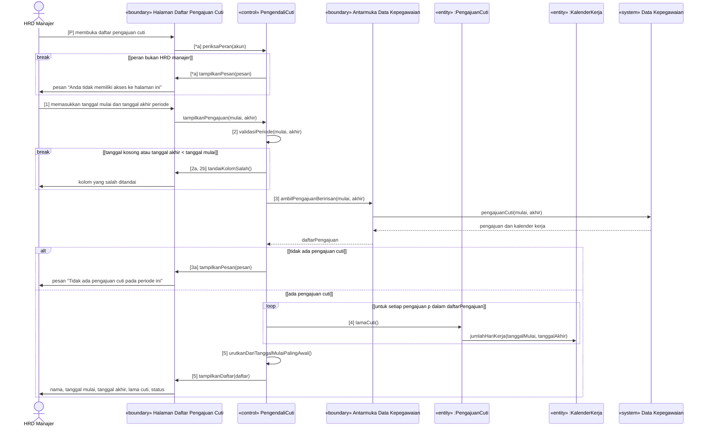

Penelusuran langkah use case ke pesan pada diagram:

| Langkah | Pesan pada diagram |
|---|---|
| *a | Halaman Daftar Pengajuan Cuti → PengendaliCuti: periksaPeran(akun) <br> PengendaliCuti → Halaman Daftar Pengajuan Cuti: tampilkanPesan(pesan) |
| 1 | HRD Manajer → Halaman Daftar Pengajuan Cuti: memasukkan tanggal mulai dan tanggal akhir periode |
| 2 | PengendaliCuti → PengendaliCuti: validasiPeriode(mulai, akhir) |
| 2a | PengendaliCuti → Halaman Daftar Pengajuan Cuti: tandaiKolomSalah() |
| 2b | PengendaliCuti → Halaman Daftar Pengajuan Cuti: tandaiKolomSalah() |
| 3 | PengendaliCuti → Antarmuka Data Kepegawaian: ambilPengajuanBeririsan(mulai, akhir) |
| 3a | PengendaliCuti → Halaman Daftar Pengajuan Cuti: tampilkanPesan(pesan) |
| 4 | PengendaliCuti → :PengajuanCuti: lamaCuti() |
| 5 | PengendaliCuti → PengendaliCuti: urutkanDariTanggalMulaiPalingAwal() <br> PengendaliCuti → Halaman Daftar Pengajuan Cuti: tampilkanDaftar(daftar) |

## US-1b Melihat riwayat cuti pegawai

HRD manajer memilih satu pegawai dari daftar. Sistem mengambil pengajuan berstatus Disetujui dengan tanggal mulai pada tahun berjalan, menghitung lama cuti tiap pengajuan, mengurutkan dari yang paling baru, lalu menampilkannya.

*Aktor primer: HRD Manajer · aktor sistem: Data Kepegawaian · 8 lifeline · 21 pesan · 3 fragmen · 6 langkah tercakup (4 utama + 2 ekstensi)*

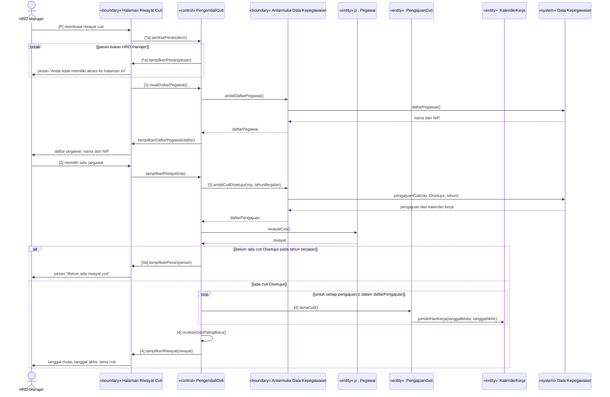

Penelusuran langkah use case ke pesan pada diagram:

| Langkah | Pesan pada diagram |
|---|---|
| *a | Halaman Riwayat Cuti → PengendaliCuti: periksaPeran(akun) <br> PengendaliCuti → Halaman Riwayat Cuti: tampilkanPesan(pesan) |
| 1 | Halaman Riwayat Cuti → PengendaliCuti: muatDaftarPegawai() |
| 2 | HRD Manajer → Halaman Riwayat Cuti: memilih satu pegawai |
| 3 | PengendaliCuti → Antarmuka Data Kepegawaian: ambilCutiDisetujui(nip, tahunBerjalan) |
| 3a | PengendaliCuti → Halaman Riwayat Cuti: tampilkanPesan(pesan) |
| 4 | PengendaliCuti → :PengajuanCuti: lamaCuti() <br> PengendaliCuti → PengendaliCuti: urutkanDariPalingBaru() <br> PengendaliCuti → Halaman Riwayat Cuti: tampilkanRiwayat(riwayat) |

## US-1c Melihat sisa cuti pegawai

Sisa cuti adalah atribut turunan Pegawai: jatah cuti tahunan dikurangi jumlah lama cuti dari pengajuan Disetujui yang tanggal mulainya pada tahun berjalan. Lama cuti tiap pengajuan dihitung memakai KalenderKerja.

*Aktor primer: HRD Manajer · aktor sistem: Data Kepegawaian · 8 lifeline · 18 pesan · 2 fragmen · 6 langkah tercakup (5 utama + 1 ekstensi)*

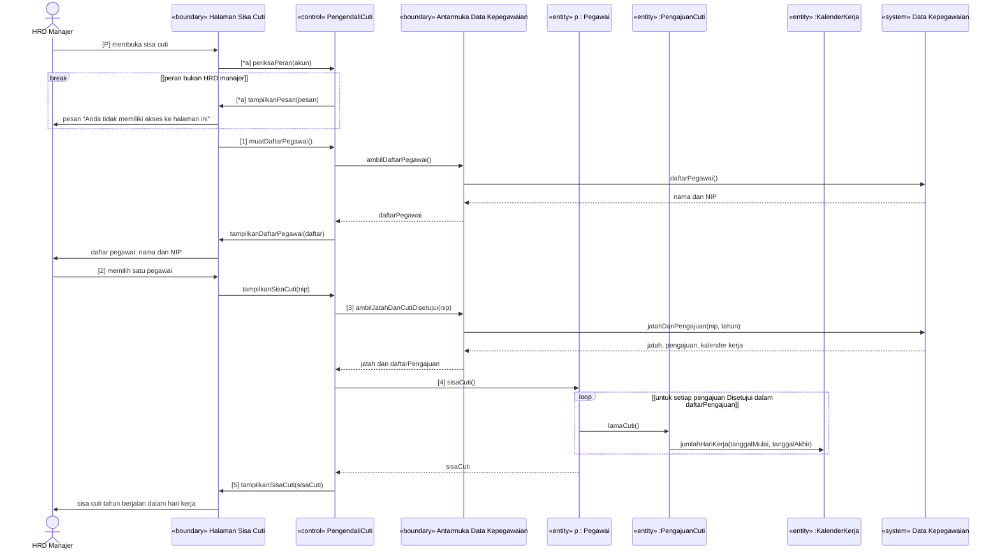

Penelusuran langkah use case ke pesan pada diagram:

| Langkah | Pesan pada diagram |
|---|---|
| *a | Halaman Sisa Cuti → PengendaliCuti: periksaPeran(akun) <br> PengendaliCuti → Halaman Sisa Cuti: tampilkanPesan(pesan) |
| 1 | Halaman Sisa Cuti → PengendaliCuti: muatDaftarPegawai() |
| 2 | HRD Manajer → Halaman Sisa Cuti: memilih satu pegawai |
| 3 | PengendaliCuti → Antarmuka Data Kepegawaian: ambilJatahDanCutiDisetujui(nip) |
| 4 | PengendaliCuti → p:Pegawai: sisaCuti() |
| 5 | PengendaliCuti → Halaman Sisa Cuti: tampilkanSisaCuti(sisaCuti) |

## US-2a Memesan tiket

Penerbangan dipilih dari hasil pencarian US-3 (extension point “hasil pencarian”). Sebelum pemesanan dibuat, kursi dialokasikan pada Penerbangan dalam satu transaksi yang dapat ditolak. Hal ini mengikuti bagian Batas agregat di Model Domain dan menjaga invarian TidakOverbooking. Pemesanan baru berstatus Waiting for the payment.

*Aktor primer: Calon Penumpang · 8 lifeline · 23 pesan · 3 fragmen + 1 ref · 13 langkah tercakup (10 utama + 3 ekstensi)*

Tidak digambar: Akun tidak digambar: pemesan dibawa sebagai konteks login. Penumpang dibuat oleh Pemesanan (komposisi).

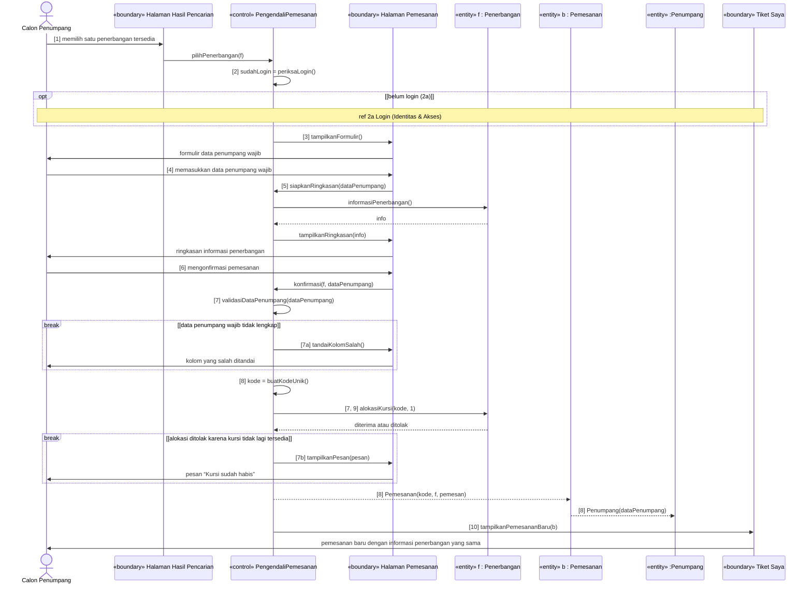

Penelusuran langkah use case ke pesan pada diagram:

| Langkah | Pesan pada diagram |
|---|---|
| 1 | Calon Penumpang → Halaman Hasil Pencarian: memilih satu penerbangan tersedia |
| 2 | PengendaliPemesanan → PengendaliPemesanan: sudahLogin = periksaLogin() |
| 2a | fragmen [belum login (2a)] <br> ref 2a  Login (Identitas & Akses) |
| 3 | PengendaliPemesanan → Halaman Pemesanan: tampilkanFormulir() |
| 4 | Calon Penumpang → Halaman Pemesanan: memasukkan data penumpang wajib |
| 5 | Halaman Pemesanan → PengendaliPemesanan: siapkanRingkasan(dataPenumpang) |
| 6 | Calon Penumpang → Halaman Pemesanan: mengonfirmasi pemesanan |
| 7 | PengendaliPemesanan → PengendaliPemesanan: validasiDataPenumpang(dataPenumpang) <br> PengendaliPemesanan → f:Penerbangan: alokasiKursi(kode, 1) |
| 7a | PengendaliPemesanan → Halaman Pemesanan: tandaiKolomSalah() |
| 7b | PengendaliPemesanan → Halaman Pemesanan: tampilkanPesan(pesan) |
| 8 | PengendaliPemesanan → PengendaliPemesanan: kode = buatKodeUnik() <br> PengendaliPemesanan → b:Pemesanan: Pemesanan(kode, f, pemesan) <br> b:Pemesanan → :Penumpang: Penumpang(dataPenumpang) |
| 9 | PengendaliPemesanan → f:Penerbangan: alokasiKursi(kode, 1) |
| 10 | PengendaliPemesanan → Tiket Saya: tampilkanPemesananBaru(b) |

## US-2b Membatalkan pemesanan

Hanya pemesanan milik pemesan yang belum Cancelled dan belum berangkat yang dapat dibatalkan. Setelah pemesan mengonfirmasi, status menjadi Cancelled, lalu kejadian domain PemesananDibatalkan melepas alokasi kursi pada Penerbangan secara bertahap (konsistensi bertahap, Model Domain).

*Aktor primer: Calon Penumpang · 6 lifeline · 14 pesan · 1 fragmen · 8 langkah tercakup (6 utama + 2 ekstensi)*

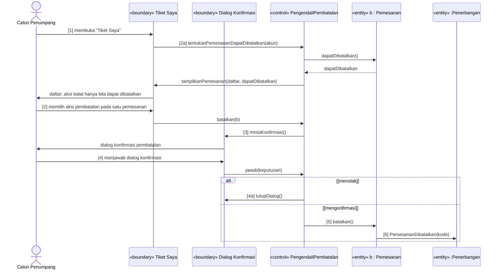

Penelusuran langkah use case ke pesan pada diagram:

| Langkah | Pesan pada diagram |
|---|---|
| 1 | Calon Penumpang → Tiket Saya: membuka “Tiket Saya” |
| 2 | Calon Penumpang → Tiket Saya: memilih aksi pembatalan pada satu pemesanan |
| 2a | Tiket Saya → PengendaliPembatalan: tentukanPemesananDapatDibatalkan(akun) |
| 3 | PengendaliPembatalan → Dialog Konfirmasi: mintaKonfirmasi() |
| 4 | Calon Penumpang → Dialog Konfirmasi: menjawab dialog konfirmasi |
| 4a | PengendaliPembatalan → Dialog Konfirmasi: tutupDialog() |
| 5 | PengendaliPembatalan → b:Pemesanan: batalkan() |
| 6 | b:Pemesanan → :Penerbangan: PemesananDibatalkan(kode) |

## US-3 Mencari penerbangan

Pencarian tidak memerlukan login. Penerbangan.cocok() sudah mencakup syarat tersedia. Hasil diurutkan dari waktu berangkat paling awal. Setelah pencarian tanpa hasil, isian formulir tetap terisi.

*Aktor primer: Calon Penumpang · 6 lifeline · 16 pesan · 2 fragmen · 9 langkah tercakup (5 utama + 4 ekstensi)*

Tidak digambar: Maskapai tidak digambar: informasi maskapai dibaca dari Penerbangan.

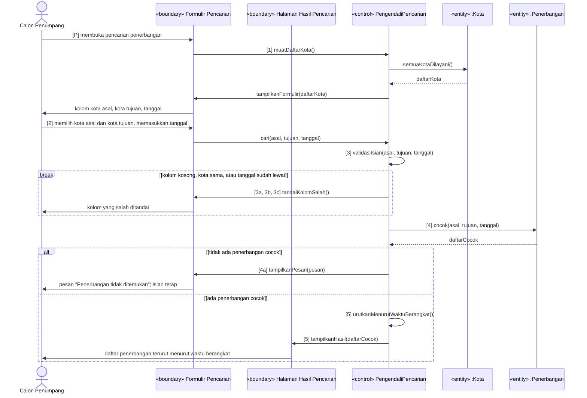

Penelusuran langkah use case ke pesan pada diagram:

| Langkah | Pesan pada diagram |
|---|---|
| 1 | Formulir Pencarian → PengendaliPencarian: muatDaftarKota() |
| 2 | Calon Penumpang → Formulir Pencarian: memilih kota asal dan kota tujuan, memasukkan tanggal |
| 3 | PengendaliPencarian → PengendaliPencarian: validasiIsian(asal, tujuan, tanggal) |
| 3a | PengendaliPencarian → Formulir Pencarian: tandaiKolomSalah() |
| 3b | PengendaliPencarian → Formulir Pencarian: tandaiKolomSalah() |
| 3c | PengendaliPencarian → Formulir Pencarian: tandaiKolomSalah() |
| 4 | PengendaliPencarian → :Penerbangan: cocok(asal, tujuan, tanggal) |
| 4a | PengendaliPencarian → Formulir Pencarian: tampilkanPesan(pesan) |
| 5 | PengendaliPencarian → PengendaliPencarian: urutkanMenurutWaktuBerangkat() <br> PengendaliPencarian → Halaman Hasil Pencarian: tampilkanHasil(daftarCocok) |

## US-4 Mencari penerbangan multi-destinasi

Setiap segmen dicari sendiri dengan Penerbangan.cocok(), hasilnya diurutkan dari harga termurah, dan jumlah penerbangan ditampilkan per segmen. Member dapat mengubah satu segmen tanpa mengisi ulang segmen lain; pencarian lalu kembali ke validasi (langkah 3).

*Aktor primer: Member Frequent Traveller · 5 lifeline · 19 pesan · 4 fragmen · 13 langkah tercakup (5 utama + 8 ekstensi)*

Tidak digambar: Kota dan Maskapai tidak digambar: daftar kota sama dengan US-3 dan maskapai dibaca dari Penerbangan.

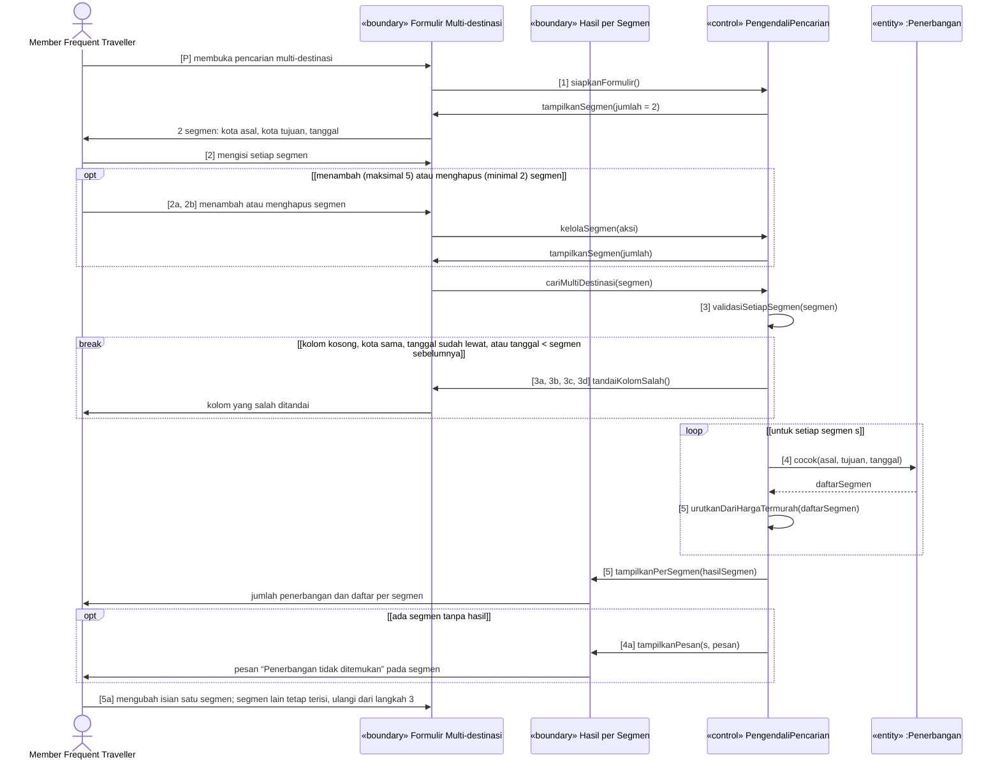

Penelusuran langkah use case ke pesan pada diagram:

| Langkah | Pesan pada diagram |
|---|---|
| 1 | Formulir Multi-destinasi → PengendaliPencarian: siapkanFormulir() |
| 2 | Member Frequent Traveller → Formulir Multi-destinasi: mengisi setiap segmen |
| 2a | Member Frequent Traveller → Formulir Multi-destinasi: menambah atau menghapus segmen |
| 2b | Member Frequent Traveller → Formulir Multi-destinasi: menambah atau menghapus segmen |
| 3 | PengendaliPencarian → PengendaliPencarian: validasiSetiapSegmen(segmen) |
| 3a | PengendaliPencarian → Formulir Multi-destinasi: tandaiKolomSalah() |
| 3b | PengendaliPencarian → Formulir Multi-destinasi: tandaiKolomSalah() |
| 3c | PengendaliPencarian → Formulir Multi-destinasi: tandaiKolomSalah() |
| 3d | PengendaliPencarian → Formulir Multi-destinasi: tandaiKolomSalah() |
| 4 | PengendaliPencarian → :Penerbangan: cocok(asal, tujuan, tanggal) |
| 4a | PengendaliPencarian → Hasil per Segmen: tampilkanPesan(s, pesan) |
| 5 | PengendaliPencarian → PengendaliPencarian: urutkanDariHargaTermurah(daftarSegmen) <br> PengendaliPencarian → Hasil per Segmen: tampilkanPerSegmen(hasilSegmen) |
| 5a | Member Frequent Traveller → Formulir Multi-destinasi: mengubah isian satu segmen; segmen lain tetap terisi, ulangi dari langkah 3 |

## US-5a Memperbarui data profil

Format hanya diperiksa untuk kolom yang terisi; kolom yang dikosongkan tersimpan kosong. Status profil adalah atribut turunan Profil: “lengkap” bila kelima data profil wajib terisi dan berformat valid, selain itu “tidak lengkap”.

*Aktor primer: Member Frequent Traveller · 5 lifeline · 16 pesan · 1 fragmen · 8 langkah tercakup (7 utama + 1 ekstensi)*

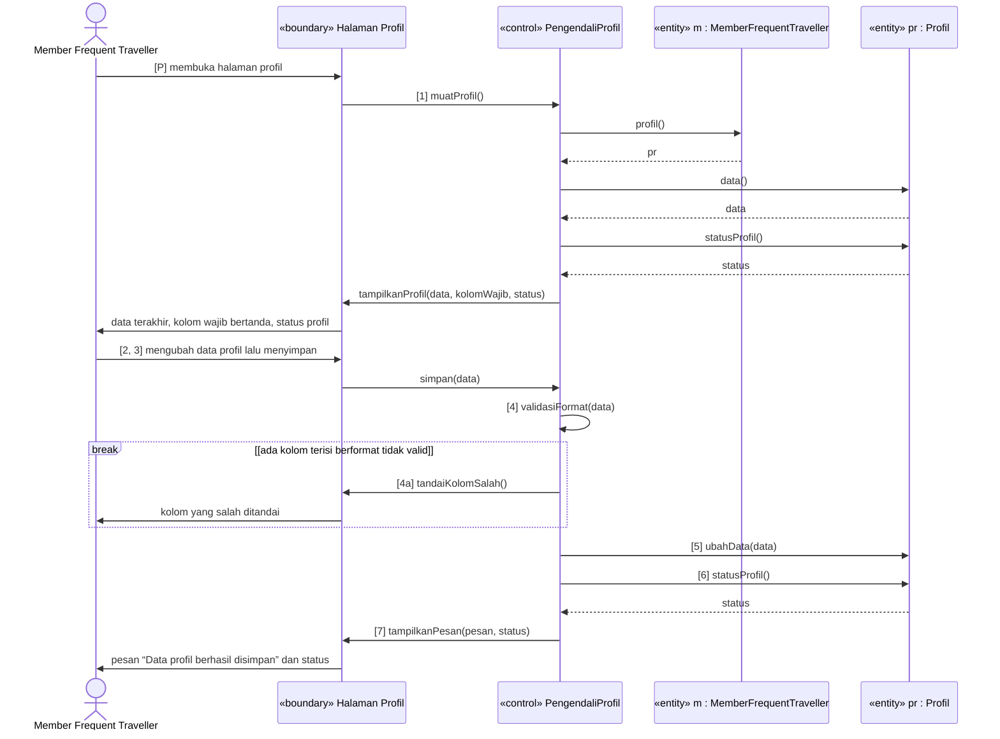

Penelusuran langkah use case ke pesan pada diagram:

| Langkah | Pesan pada diagram |
|---|---|
| 1 | Halaman Profil → PengendaliProfil: muatProfil() |
| 2 | Member Frequent Traveller → Halaman Profil: mengubah data profil lalu menyimpan |
| 3 | Member Frequent Traveller → Halaman Profil: mengubah data profil lalu menyimpan |
| 4 | PengendaliProfil → PengendaliProfil: validasiFormat(data) |
| 4a | PengendaliProfil → Halaman Profil: tandaiKolomSalah() |
| 5 | PengendaliProfil → pr:Profil: ubahData(data) |
| 6 | PengendaliProfil → pr:Profil: statusProfil() |
| 7 | PengendaliProfil → Halaman Profil: tampilkanPesan(pesan, status) |

## US-5b Memvalidasi tiket

Status profil diperiksa sebelum kode dicari. Pada tiket yang tidak cocok, data penumpang tidak ditampilkan. perjalananTercatat adalah himpunan, sehingga tiket yang sama tidak tercatat dua kali; pada kasus itu pesan “Tiket sudah tervalidasi” ditampilkan.

*Aktor primer: Member Frequent Traveller · 6 lifeline · 23 pesan · 6 fragmen · 14 langkah tercakup (8 utama + 6 ekstensi)*

Tidak digambar: Penumpang tidak digambar: pencocokan nama dan nomor identitas terjadi di dalam Pemesanan.cocokDengan().

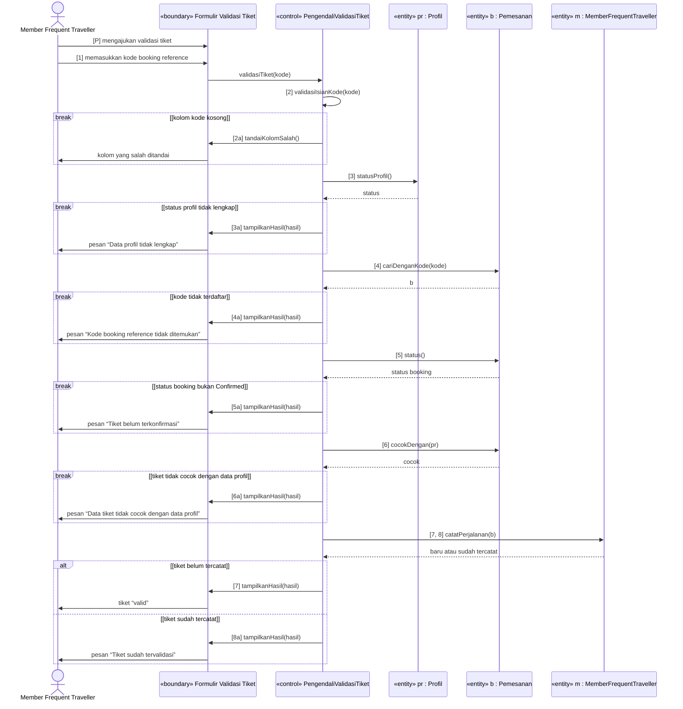

Penelusuran langkah use case ke pesan pada diagram:

| Langkah | Pesan pada diagram |
|---|---|
| 1 | Member Frequent Traveller → Formulir Validasi Tiket: memasukkan kode booking reference |
| 2 | PengendaliValidasiTiket → PengendaliValidasiTiket: validasiIsianKode(kode) |
| 2a | PengendaliValidasiTiket → Formulir Validasi Tiket: tandaiKolomSalah() |
| 3 | PengendaliValidasiTiket → pr:Profil: statusProfil() |
| 3a | PengendaliValidasiTiket → Formulir Validasi Tiket: tampilkanHasil(hasil) |
| 4 | PengendaliValidasiTiket → b:Pemesanan: cariDenganKode(kode) |
| 4a | PengendaliValidasiTiket → Formulir Validasi Tiket: tampilkanHasil(hasil) |
| 5 | PengendaliValidasiTiket → b:Pemesanan: status() |
| 5a | PengendaliValidasiTiket → Formulir Validasi Tiket: tampilkanHasil(hasil) |
| 6 | PengendaliValidasiTiket → b:Pemesanan: cocokDengan(pr) |
| 6a | PengendaliValidasiTiket → Formulir Validasi Tiket: tampilkanHasil(hasil) |
| 7 | PengendaliValidasiTiket → m:MemberFrequentTraveller: catatPerjalanan(b) <br> PengendaliValidasiTiket → Formulir Validasi Tiket: tampilkanHasil(hasil) |
| 8 | PengendaliValidasiTiket → m:MemberFrequentTraveller: catatPerjalanan(b) |
| 8a | PengendaliValidasiTiket → Formulir Validasi Tiket: tampilkanHasil(hasil) |

## US-6a Menyaring hasil pencarian berdasarkan jam keberangkatan

Filter bekerja pada hasil US-3 yang sudah ditampilkan (extension point “hasil pencarian”) dan tidak menyimpan apa pun. Kolom filter berada pada halaman hasil pencarian, jadi hanya ada satu boundary. Rentang jam menyertakan kedua batas.

*Aktor primer: Member Frequent Traveller · 4 lifeline · 16 pesan · 5 fragmen · 9 langkah tercakup (4 utama + 5 ekstensi)*

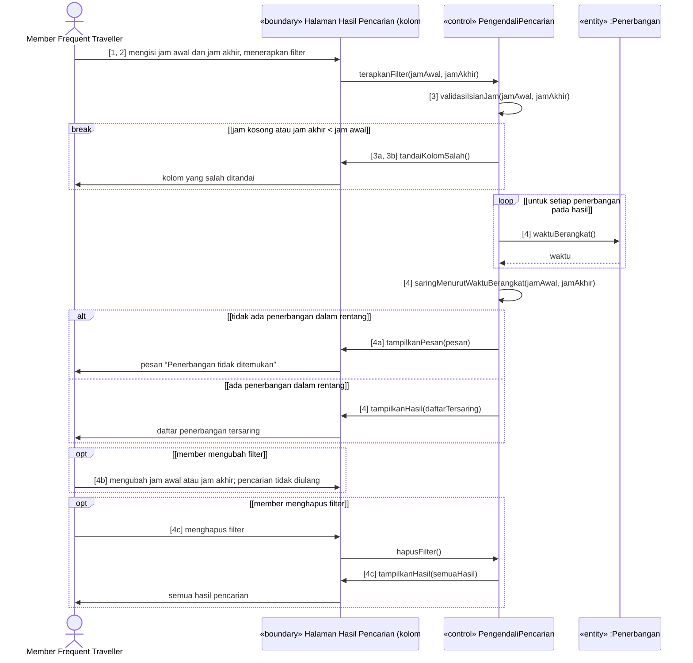

Penelusuran langkah use case ke pesan pada diagram:

| Langkah | Pesan pada diagram |
|---|---|
| 1 | Member Frequent Traveller → Halaman Hasil Pencarian (kolom filter jam): mengisi jam awal dan jam akhir, menerapkan filter |
| 2 | Member Frequent Traveller → Halaman Hasil Pencarian (kolom filter jam): mengisi jam awal dan jam akhir, menerapkan filter |
| 3 | PengendaliPencarian → PengendaliPencarian: validasiIsianJam(jamAwal, jamAkhir) |
| 3a | PengendaliPencarian → Halaman Hasil Pencarian (kolom filter jam): tandaiKolomSalah() |
| 3b | PengendaliPencarian → Halaman Hasil Pencarian (kolom filter jam): tandaiKolomSalah() |
| 4 | PengendaliPencarian → :Penerbangan: waktuBerangkat() <br> PengendaliPencarian → PengendaliPencarian: saringMenurutWaktuBerangkat(jamAwal, jamAkhir) <br> PengendaliPencarian → Halaman Hasil Pencarian (kolom filter jam): tampilkanHasil(daftarTersaring) |
| 4a | PengendaliPencarian → Halaman Hasil Pencarian (kolom filter jam): tampilkanPesan(pesan) |
| 4b | Member Frequent Traveller → Halaman Hasil Pencarian (kolom filter jam): mengubah jam awal atau jam akhir; pencarian tidak diulang |
| 4c | Member Frequent Traveller → Halaman Hasil Pencarian (kolom filter jam): menghapus filter <br> PengendaliPencarian → Halaman Hasil Pencarian (kolom filter jam): tampilkanHasil(semuaHasil) |

## US-6b Membandingkan harga penerbangan

Pengurutan dan pembandingan bekerja pada hasil US-3 (extension point “hasil pencarian”). Tampilan perbandingan hanya terbuka bila 2 atau 3 penerbangan dipilih, memakai harga yang sama dengan hasil pencarian, dan tidak menyimpan apa pun. Tampilan ini menjadi extension point “tampilan perbandingan” bagi US-6c.

*Aktor primer: Member Frequent Traveller · 5 lifeline · 18 pesan · 4 fragmen · 9 langkah tercakup (6 utama + 3 ekstensi)*

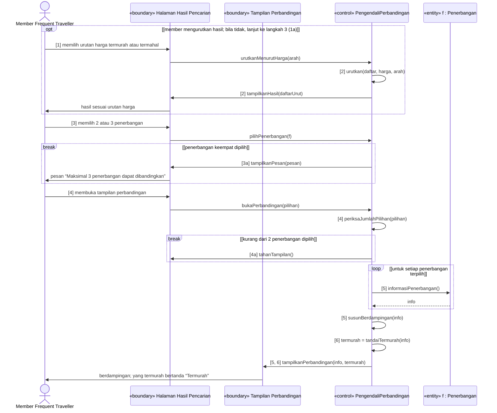

Penelusuran langkah use case ke pesan pada diagram:

| Langkah | Pesan pada diagram |
|---|---|
| 1 | Member Frequent Traveller → Halaman Hasil Pencarian: memilih urutan harga termurah atau termahal |
| 1a | fragmen [member mengurutkan hasil; bila tidak, lanjut ke langkah 3 (1a)] |
| 2 | PengendaliPerbandingan → PengendaliPerbandingan: urutkan(daftar, harga, arah) <br> PengendaliPerbandingan → Halaman Hasil Pencarian: tampilkanHasil(daftarUrut) |
| 3 | Member Frequent Traveller → Halaman Hasil Pencarian: memilih 2 atau 3 penerbangan |
| 3a | PengendaliPerbandingan → Halaman Hasil Pencarian: tampilkanPesan(pesan) |
| 4 | Member Frequent Traveller → Halaman Hasil Pencarian: membuka tampilan perbandingan <br> PengendaliPerbandingan → PengendaliPerbandingan: periksaJumlahPilihan(pilihan) |
| 4a | PengendaliPerbandingan → Halaman Hasil Pencarian: tahanTampilan() |
| 5 | PengendaliPerbandingan → f:Penerbangan: informasiPenerbangan() <br> PengendaliPerbandingan → PengendaliPerbandingan: susunBerdampingan(info) <br> PengendaliPerbandingan → Tampilan Perbandingan: tampilkanPerbandingan(info, termurah) |
| 6 | PengendaliPerbandingan → PengendaliPerbandingan: termurah = tandaiTermurah(info) <br> PengendaliPerbandingan → Tampilan Perbandingan: tampilkanPerbandingan(info, termurah) |

## US-6c Memesan penerbangan dari tampilan perbandingan

Use case ini memperluas US-6b dan menyertakan US-2a. Setelah ketersediaan diperiksa dan halaman pemesanan dibuka, proses pemesanan mengikuti US-2a mulai langkah 2 (diacu dengan ref). Bila member kembali, pilihan perbandingan dipulihkan.

*Aktor primer: Member Frequent Traveller · 5 lifeline · 11 pesan · 2 fragmen + 1 ref · 6 langkah tercakup (4 utama + 2 ekstensi)*

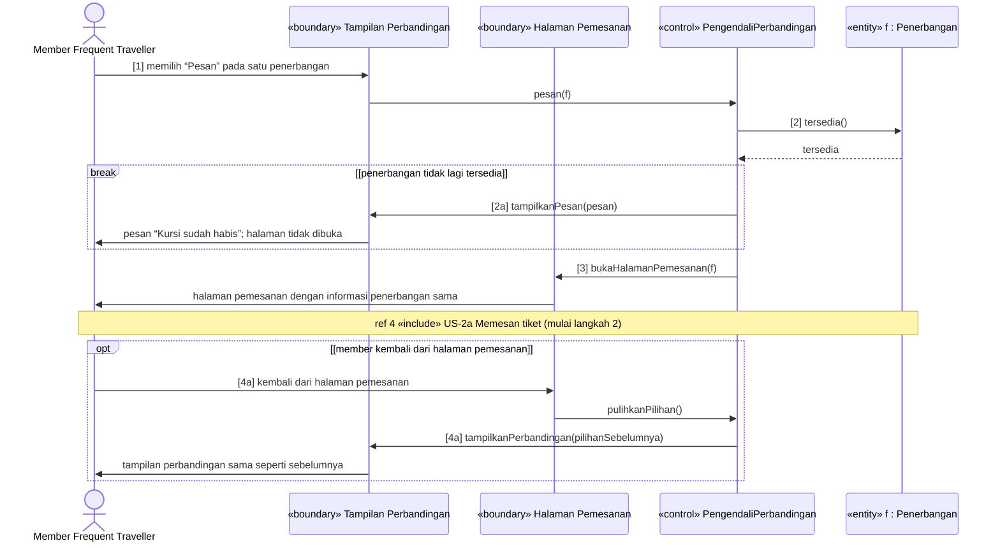

Penelusuran langkah use case ke pesan pada diagram:

| Langkah | Pesan pada diagram |
|---|---|
| 1 | Member Frequent Traveller → Tampilan Perbandingan: memilih “Pesan” pada satu penerbangan |
| 2 | PengendaliPerbandingan → f:Penerbangan: tersedia() |
| 2a | PengendaliPerbandingan → Tampilan Perbandingan: tampilkanPesan(pesan) |
| 3 | PengendaliPerbandingan → Halaman Pemesanan: bukaHalamanPemesanan(f) |
| 4 | ref 4  «include» US-2a Memesan tiket (mulai langkah 2) |
| 4a | Member Frequent Traveller → Halaman Pemesanan: kembali dari halaman pemesanan <br> PengendaliPerbandingan → Tampilan Perbandingan: tampilkanPerbandingan(pilihanSebelumnya) |

## US-7 Memantau status booking

Saat halaman dibuka, semua pemesanan tampil dari yang paling baru dibuat tanpa filter aktif. Filter memilih satu dari empat status atau “Semua status”.

*Aktor primer: Manajer Travel · 5 lifeline · 19 pesan · 4 fragmen · 6 langkah tercakup (3 utama + 3 ekstensi)*

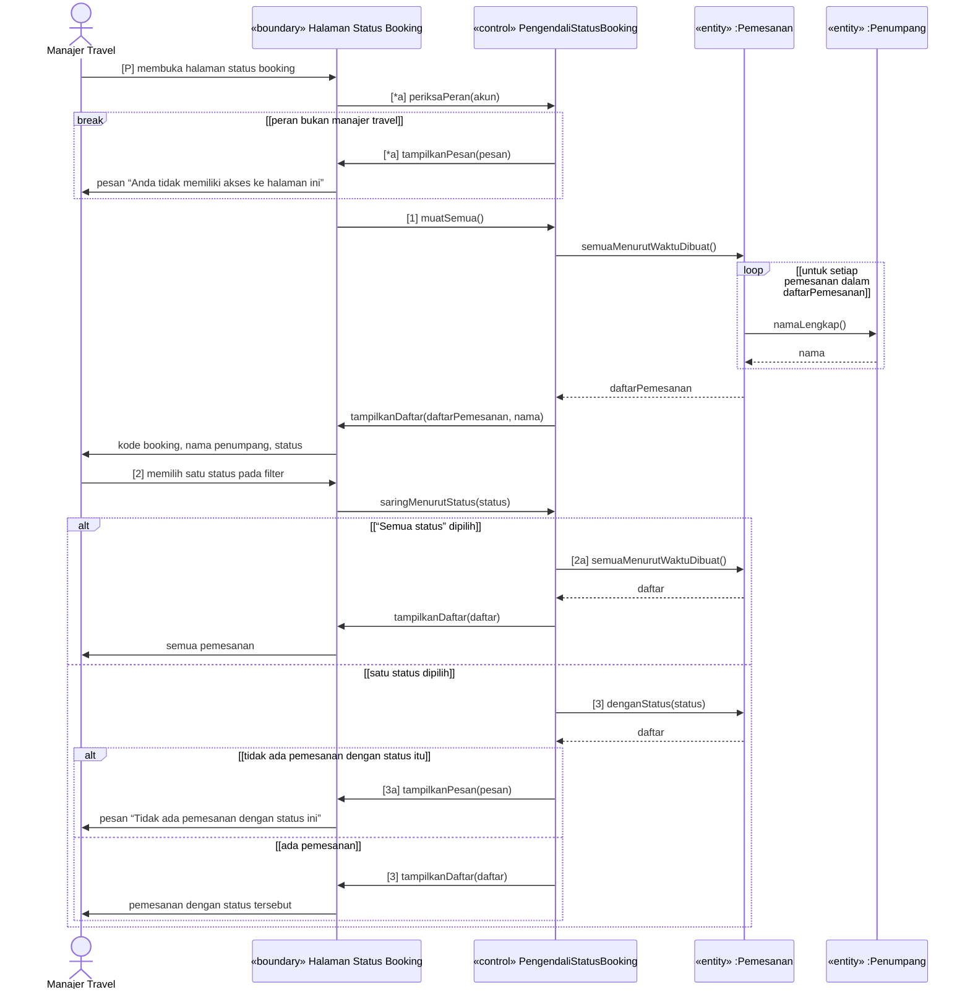

Penelusuran langkah use case ke pesan pada diagram:

| Langkah | Pesan pada diagram |
|---|---|
| *a | Halaman Status Booking → PengendaliStatusBooking: periksaPeran(akun) <br> PengendaliStatusBooking → Halaman Status Booking: tampilkanPesan(pesan) |
| 1 | Halaman Status Booking → PengendaliStatusBooking: muatSemua() |
| 2 | Manajer Travel → Halaman Status Booking: memilih satu status pada filter |
| 2a | PengendaliStatusBooking → :Pemesanan: semuaMenurutWaktuDibuat() |
| 3 | PengendaliStatusBooking → :Pemesanan: denganStatus(status) <br> PengendaliStatusBooking → Halaman Status Booking: tampilkanDaftar(daftar) |
| 3a | PengendaliStatusBooking → Halaman Status Booking: tampilkanPesan(pesan) |

## US-8a Mencari penerbangan untuk pengunjung

Hasil hanya memuat penerbangan tersedia yang cocok dengan isian dan sisa kursinya sama dengan atau lebih dari jumlah penumpang. Story tidak menentukan urutan hasil, jadi urutan tidak digambar.

*Aktor primer: Manajer Travel · 5 lifeline · 11 pesan · 2 fragmen · 9 langkah tercakup (4 utama + 5 ekstensi)*

Tidak digambar: Kota dan Maskapai tidak digambar, dengan alasan yang sama seperti US-3.

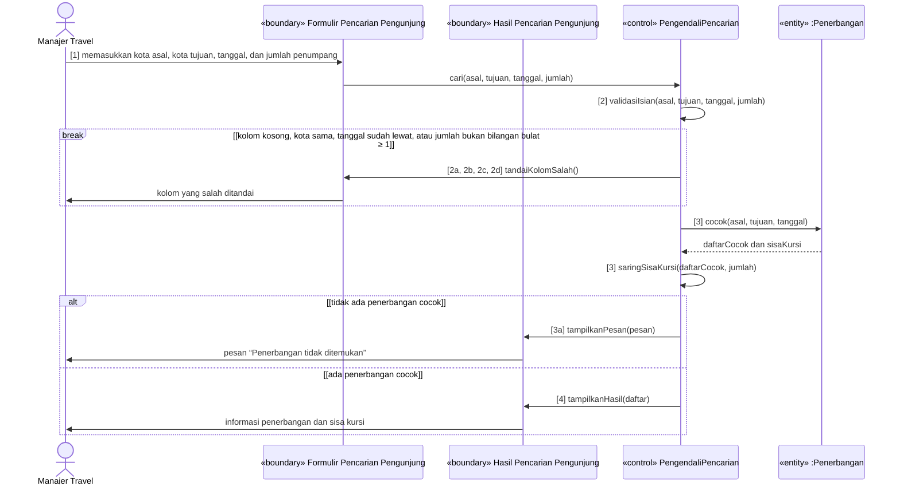

Penelusuran langkah use case ke pesan pada diagram:

| Langkah | Pesan pada diagram |
|---|---|
| 1 | Manajer Travel → Formulir Pencarian Pengunjung: memasukkan kota asal, kota tujuan, tanggal, dan jumlah penumpang |
| 2 | PengendaliPencarian → PengendaliPencarian: validasiIsian(asal, tujuan, tanggal, jumlah) |
| 2a | PengendaliPencarian → Formulir Pencarian Pengunjung: tandaiKolomSalah() |
| 2b | PengendaliPencarian → Formulir Pencarian Pengunjung: tandaiKolomSalah() |
| 2c | PengendaliPencarian → Formulir Pencarian Pengunjung: tandaiKolomSalah() |
| 2d | PengendaliPencarian → Formulir Pencarian Pengunjung: tandaiKolomSalah() |
| 3 | PengendaliPencarian → :Penerbangan: cocok(asal, tujuan, tanggal) <br> PengendaliPencarian → PengendaliPencarian: saringSisaKursi(daftarCocok, jumlah) |
| 3a | PengendaliPencarian → Hasil Pencarian Pengunjung: tampilkanPesan(pesan) |
| 4 | PengendaliPencarian → Hasil Pencarian Pengunjung: tampilkanHasil(daftar) |

## US-8b Memesan tiket atas nama pengunjung

Satu pemesanan memuat semua pengunjung terpilih dengan satu kode booking reference. Data penumpang disalin dari profil tiap pengunjung. Penolakan karena profil tidak lengkap menyebut nama pengunjung. Alokasi kursi dilakukan lebih dahulu pada Penerbangan sebelum Pemesanan dibuat (Model Domain, Batas agregat).

*Aktor primer: Manajer Travel · 8 lifeline · 24 pesan · 6 fragmen · 10 langkah tercakup (7 utama + 3 ekstensi)*

Tidak digambar: ManajerTravel tidak digambar: pemesan dibawa sebagai konteks login.

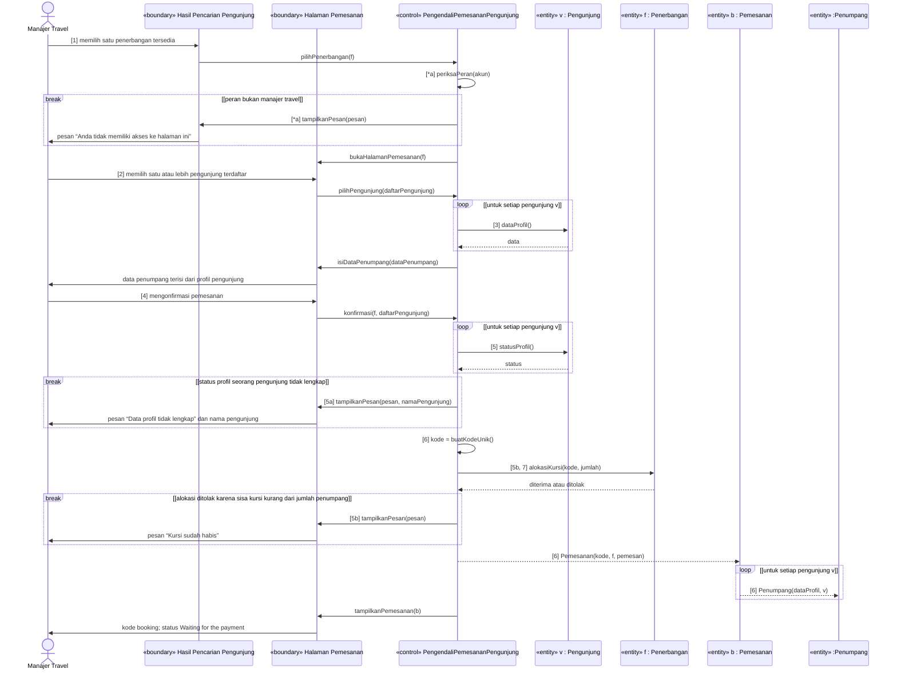

Penelusuran langkah use case ke pesan pada diagram:

| Langkah | Pesan pada diagram |
|---|---|
| *a | PengendaliPemesananPengunjung → PengendaliPemesananPengunjung: periksaPeran(akun) <br> PengendaliPemesananPengunjung → Hasil Pencarian Pengunjung: tampilkanPesan(pesan) |
| 1 | Manajer Travel → Hasil Pencarian Pengunjung: memilih satu penerbangan tersedia |
| 2 | Manajer Travel → Halaman Pemesanan Pengunjung: memilih satu atau lebih pengunjung terdaftar |
| 3 | PengendaliPemesananPengunjung → v:Pengunjung: dataProfil() |
| 4 | Manajer Travel → Halaman Pemesanan Pengunjung: mengonfirmasi pemesanan |
| 5 | PengendaliPemesananPengunjung → v:Pengunjung: statusProfil() |
| 5a | PengendaliPemesananPengunjung → Halaman Pemesanan Pengunjung: tampilkanPesan(pesan, namaPengunjung) |
| 5b | PengendaliPemesananPengunjung → f:Penerbangan: alokasiKursi(kode, jumlah) <br> PengendaliPemesananPengunjung → Halaman Pemesanan Pengunjung: tampilkanPesan(pesan) |
| 6 | PengendaliPemesananPengunjung → PengendaliPemesananPengunjung: kode = buatKodeUnik() <br> PengendaliPemesananPengunjung → b:Pemesanan: Pemesanan(kode, f, pemesan) <br> b:Pemesanan → :Penumpang: Penumpang(dataProfil, v) |
| 7 | PengendaliPemesananPengunjung → f:Penerbangan: alokasiKursi(kode, jumlah) |

## US-8c Melihat tiket yang dipesankan

“Tiket Saya” mengambil pemesanan yang mencantumkan akun pengunjung sebagai penumpang (Penumpang.mewakili); pemesanan yang tidak mencantumkannya tidak diambil.

*Aktor primer: Pengunjung · 6 lifeline · 9 pesan · 3 fragmen · 4 langkah tercakup (3 utama + 1 ekstensi)*

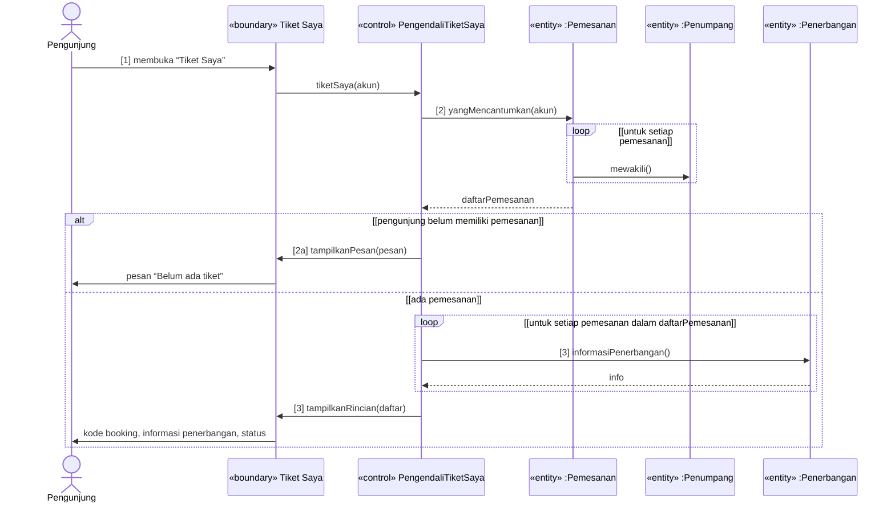

Penelusuran langkah use case ke pesan pada diagram:

| Langkah | Pesan pada diagram |
|---|---|
| 1 | Pengunjung → Tiket Saya: membuka “Tiket Saya” |
| 2 | PengendaliTiketSaya → :Pemesanan: yangMencantumkan(akun) |
| 2a | PengendaliTiketSaya → Tiket Saya: tampilkanPesan(pesan) |
| 3 | PengendaliTiketSaya → :Penerbangan: informasiPenerbangan() <br> PengendaliTiketSaya → Tiket Saya: tampilkanRincian(daftar) |

## US-8d Menerima e-tiket melalui email

Maskapai adalah aktor sistem proaktif (memulai urutan), jadi digambar paling kiri. Sistem hanya menerbitkan dan mengirim e-tiket setelah status menjadi Confirmed. Penerima ditentukan oleh Pemesanan.penerimaETiket() (keputusan G6): email pada profil setiap pengunjung yang tercantum sebagai penumpang. Pengunjung hanya menerima hasil di akhir, jadi digambar di kanan Layanan Email.

*Aktor primer: Pengunjung · aktor sistem: Maskapai, Layanan Email · 8 lifeline · 9 pesan · 1 fragmen · 3 langkah tercakup (3 utama + 0 ekstensi)*

Tidak digambar: Profil dan Penumpang tidak digambar: dibaca di dalam Pemesanan.penerimaETiket().

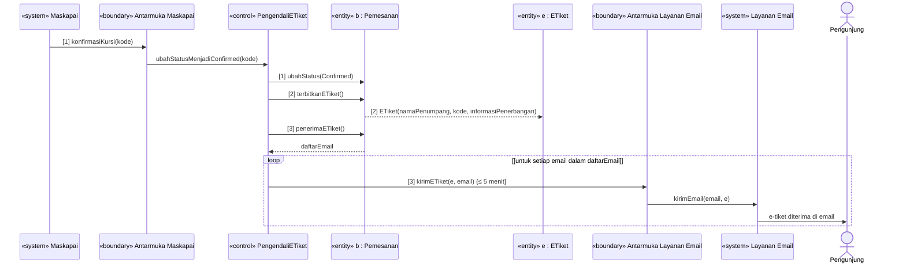

Penelusuran langkah use case ke pesan pada diagram:

| Langkah | Pesan pada diagram |
|---|---|
| 1 | Maskapai → Antarmuka Maskapai: konfirmasiKursi(kode) <br> PengendaliETiket → b:Pemesanan: ubahStatus(Confirmed) |
| 2 | PengendaliETiket → b:Pemesanan: terbitkanETiket() <br> b:Pemesanan → e:ETiket: ETiket(namaPenumpang, kode, informasiPenerbangan) |
| 3 | PengendaliETiket → b:Pemesanan: penerimaETiket() <br> PengendaliETiket → Antarmuka Layanan Email: kirimETiket(e, email) {≤ 5 menit} |

## US-9 Memeriksa status booking dengan kode booking reference

Kode dinormalisasi (huruf besar/kecil dan spasi di awal atau akhir diabaikan) sebelum dicari, sesuai KodeBookingReference.normal(). Untuk kode yang tidak terdaftar, tidak ada data pemesanan yang ditampilkan.

*Aktor primer: Manajer Travel · 6 lifeline · 19 pesan · 4 fragmen · 8 langkah tercakup (5 utama + 3 ekstensi)*

Bahan masukan: Bagian B User Story yang Diperbaiki (US1–9), Diagram Use Case, Diagram Aktivitas & Robustness, dan Model Domain.

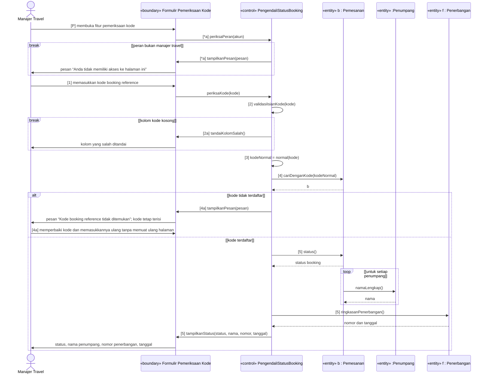

Penelusuran langkah use case ke pesan pada diagram:

| Langkah | Pesan pada diagram |
|---|---|
| *a | Formulir Pemeriksaan Kode → PengendaliStatusBooking: periksaPeran(akun) <br> PengendaliStatusBooking → Formulir Pemeriksaan Kode: tampilkanPesan(pesan) |
| 1 | Manajer Travel → Formulir Pemeriksaan Kode: memasukkan kode booking reference |
| 2 | PengendaliStatusBooking → PengendaliStatusBooking: validasiIsianKode(kode) |
| 2a | PengendaliStatusBooking → Formulir Pemeriksaan Kode: tandaiKolomSalah() |
| 3 | PengendaliStatusBooking → PengendaliStatusBooking: kodeNormal = normal(kode) |
| 4 | PengendaliStatusBooking → b:Pemesanan: cariDenganKode(kodeNormal) |
| 4a | PengendaliStatusBooking → Formulir Pemeriksaan Kode: tampilkanPesan(pesan) <br> Manajer Travel → Formulir Pemeriksaan Kode: memperbaiki kode dan memasukkannya ulang tanpa memuat ulang halaman |
| 5 | PengendaliStatusBooking → b:Pemesanan: status() <br> PengendaliStatusBooking → f:Penerbangan: ringkasanPenerbangan() <br> PengendaliStatusBooking → Formulir Pemeriksaan Kode: tampilkanStatus(status, nama, nomor, tanggal) |

## Operasi baru yang diusulkan untuk Model Domain

Operasi berikut dipakai pada diagram sequence tetapi namanya belum ada di Model Domain. Semuanya muncul karena tahap desain memerlukan kueri atau perubahan yang di Model Domain baru berupa atribut turunan atau kontrak. Pakai nama-nama ini di kode agar konsisten dengan diagram.

| Kelas | Operasi | Dipakai pada |
|---|---|---|
| Kota | `semuaKotaDilayani` | US-3 |
| MemberFrequentTraveller | `catatPerjalanan` | US-5b |
| Pemesanan | `cariDenganKode` | US-5b, US-9 |
| Pemesanan | `dapatDibatalkan` | US-2b |
| Pemesanan | `denganStatus` | US-7 |
| Pemesanan | `semuaMenurutWaktuDibuat` | US-7 |
| Pemesanan | `terbitkanETiket` | US-8d |
| Pemesanan | `ubahStatus` | US-8d |
| Pemesanan | `yangMencantumkan` | US-8c |
| Penerbangan | `alokasiKursi` | US-2a, US-8b |
| Penerbangan | `informasiPenerbangan` | US-2a, US-6b, US-8c |
| Penerbangan | `ringkasanPenerbangan` | US-9 |
| Pengunjung | `dataProfil` | US-8b |
| Profil | `ubahData` | US-5a |

## Keputusan desain dan keterbatasan

- Nama lifeline «control» (mis. PengendaliCuti, PengendaliPemesanan) adalah nama baru.
- Pesan `Penerbangan.cocok()` dikirim ke lifeline anonim `:Penerbangan` yang mewakili himpunan penerbangan.
- Pesan dari Layanan Email ke Pengunjung (US-8d) berada di luar sistem. Pesan itu digambar karena menjadi jaminan sukses use case.
- US-5a, US-5b, US-4, dan US-8a tidak menyatakan apakah login diperlukan (celah G12). Diagram tidak menambahkan pemeriksaan login pada use case tersebut.
- Penulis diagram mencatat bahwa spesifikasi OMG UML 2.5.1 tidak dibuka langsung; notasi dipilih dari pengetahuan umum UML dan cuplikan sumber (Ambler, ICONIX, Larman). Cocokkan dengan versi UML yang diwajibkan sebelum dipakai sebagai laporan resmi tugas.
